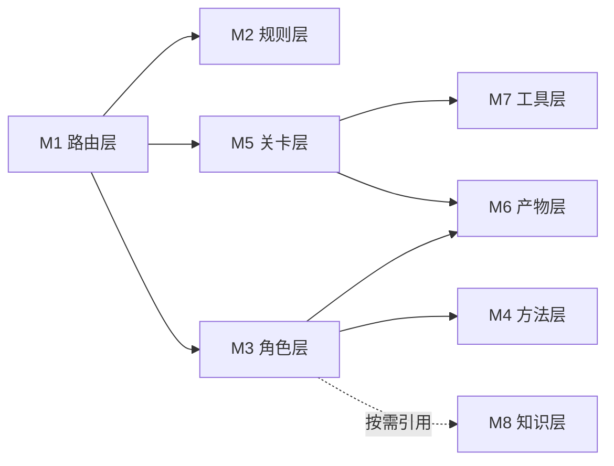

<!-- 创建时间: 2026-10-30 20:55 -->
<!-- 最后修改: 2026-10-30 20:55 -->

# AI Team 治理体系 - 架构设计文档

> 依据：`agent-doc/result-first/2026-10-30-01-agent流程整改-result-blueprint.md`
> 目标：抑制发散、强制自检、保证交付质量

---

## 1. 架构风格与选型

### 1.1 架构风格

| 项 | 选择 | 理由 |
|----|------|------|
| 风格 | 分层文件契约 + 关卡流水线（Pipeline with Gates） | 无运行时状态服务，全部靠文件落盘与退出码判定，可跨 AI 助手移植 |
| 编排 | 单一编排者（PM Agent）+ 独立判定者（核查/稽查/测试 subagent） | 消除"自己写自己判"的自证循环 |
| 状态 | 任务级目录隔离（`agent-doc/tasks/{task_id}/`） | 多任务互不污染，状态可审计 |
| 判定 | 机读优先（JSON + 退出码），人工仅做裁决 | ✅ 必须有证据，无法凭空填写 |

### 1.2 技术栈

| 层 | 技术 | 版本/约束 |
|----|------|----------|
| 入口 | Markdown 规则（`AGENTS.md`） | ≤120 行，opencode 自动加载 |
| 规则 | Markdown + 规则 ID | `R-<域>-<序号>`，唯一 |
| 方法 | Markdown Skill + `registry.json` | JSON Schema 校验 |
| 工具 | Python | 3.11+，仅标准库 |
| 验证 | PowerShell 7 / Git | win32 环境默认 |

### 1.3 架构决策记录（ADR）

| ID | 决策 | 备选 | 结论与理由 |
|----|------|------|-----------|
| ADR-001 | 模板从 `AGENTS.md` 拆出到 `.ai-team/templates/stages/` | 保留 551 行单文件 | 拆分。常驻上下文只保留门禁+路由，单次按需加载 1 个模板 |
| ADR-002 | 子计划"最终结果"由脚本从蓝图 BLK 抽取 | 人工逐字拷贝 | 用脚本。人工无法保证逐字一致，且蓝图变更后需改 N 份 |
| ADR-003 | 核查/稽查/测试改为 subagent 隔离调用 | 同一上下文角色扮演 | 隔离。输入仅"产物路径+判定标准+schema"，避免共享结论偏见 |
| ADR-004 | 状态从单文件 `workflow-status.md` 迁移到任务目录 | 继续单文件 | 任务目录。单文件只能承载单任务，且已发生状态失真 |
| ADR-005 | 关卡判定以脚本退出码为准 | 由 Agent 填 ✅ | 脚本+vidence。退出码 0/1/2 三态可机读 |
| ADR-006 | 吸收外部能力设 4 道准入门禁 | 直接复制文件 | 门禁。无许可信息一律拒绝，重合 >70% 必须合并 |
| ADR-007 | Python 脚本归 `code-dev` 路由的 `tools` 分支 | 新增 Python Agent | 不新增角色，路由表加 `tools` 技术栈分支，由 code-dev 直管 |

---

## 2. 模块划分

| 模块 | 职责 | 关键文件 |
|------|------|---------|
| M1 路由层 | 分级 L0–L3、10 条硬规则、阶段→模板索引、技术栈路由 | `AGENTS.md` |
| M2 规则层 | 流程/关卡/技能/吸收规则本体 | `.ai-team/rules/*.md` |
| M3 角色层 | 角色契约（何时调谁、输入输出、禁写域） | `.ai-team/agents/*/agent.md` |
| M4 方法层 | Skill 方法与注册、加载声明 | `.ai-team/skills/**`、`registry.json` |
| M5 关卡层 | G1–G5 定义、报告 schema、阶段模板 | `rules/gate-rules.md`、`templates/stages/` |
| M6 产物层 | 状态、日志、报告、计划、代码 | `agent-doc/tasks/{task_id}/` |
| M7 工具层 | 5 个判定/生成脚本 | `tools/scripts/*.py` |
| M8 知识层 | 经验、决策、模式、领域知识 | `.ai-team/knowledge-base/` |

### 2.1 模块依赖关系

### 2.2 模块间通信

| 调用方 | 被调方 | 方式 | 契约 |
|--------|--------|------|------|
| M1 | M2/M5 | 文件引用 | 规则 ID、模板文件名 |
| M3 PM | M3 判定者 | subagent | 输入 `{artifacts[], criteria, schema}`；输出固定字段 JSON |
| M5 | M7 | 命令行 | `--task`、`--gate`；退出码 0/1/2 |
| M5/M3 | M6 | 文件写入 | 仅追加 `gate-log.jsonl`，禁改写历史 |

---

## 3. 部署架构

| 环境 | 载体 | 内容 | 说明 |
|------|------|------|------|
| 开发 | 本仓 Git | 全量 `.ai-team/` + `AGENTS.md` | opencode 运行时 |
| 复用（其他项目） | 目标项目根 | 仅 `AGENTS.md` + `.ai-team/` + `tools/scripts/` | 不复制 `agent-doc/` |
| 验证 | 本地 | Python 3.11+、PowerShell 7、Git | 关卡脚本幂等可重跑 |

### 3.1 可移植性

| 宿主 | 入口方式 |
|------|---------|
| opencode | `AGENTS.md` 自动加载 |
| GitHub Copilot | 复制 `AGENTS.md` 到 `.github/copilot-instructions.md` |
| Claude Code | `CLAUDE.md` 内 `@AGENTS.md` 导入 |
| Codex CLI | 复制到 `codex.md` |

---

## 4. 交叉关注点

| 关注点 | 方案 |
|--------|------|
| 权限隔离 | 每个角色声明"可写域"，越域写入由稽查判 `E-CMP-02` |
| 审计 | `gate-log.jsonl` 只追加；每条含 ts/actor/gate/round/证据摘要 sha256 |
| 错误处理 | 关卡失败返回 `blocking[]`（R-ID 或 BLK-ID），禁止返回自然语言结论 |
| 幂等 | 脚本无副作用写入，重复执行结论一致 |
| 防发散 | L0/L1 不产出蓝图；单次只加载 1 个模板；禁止全量输出模板 |
| 防死循环 | 同关卡 2 轮驳回上限，超出强制升级用户 |
| 文档元数据 | 非代码文档首两行必须含创建/最后修改时间，由 `metadata_check.py` 校验 |
| 安全 | 不落盘密钥；外部能力导入前做许可与来源审查 |

---

## 5. 与旧架构的差异

| 维度 | 旧 | 新 |
|------|-----|-----|
| 常驻上下文 | 551 行 AGENTS.md | ≤120 行 + 按需 1 模板 |
| 状态 | 单文件单任务 | 任务目录隔离 |
| 判定 | Agent 填 ✅ | 脚本退出码 + 证据 |
| 判定者 | PM 角色扮演 | 独立 subagent |
| 子计划内容 | 人工逐字拷贝 | 脚本按 BLK 抽取 |
| Skill | 路径表 | 注册表 + 触发匹配 + 加载声明 |
| 外部能力 | 无流程 | 4 道门禁 + 回归用例 |
| 死链 | 24 处（`.cursorrules` 16 / `.opencode` 7 / skill 1） | 0 处，`link_check.py` 守住 |
