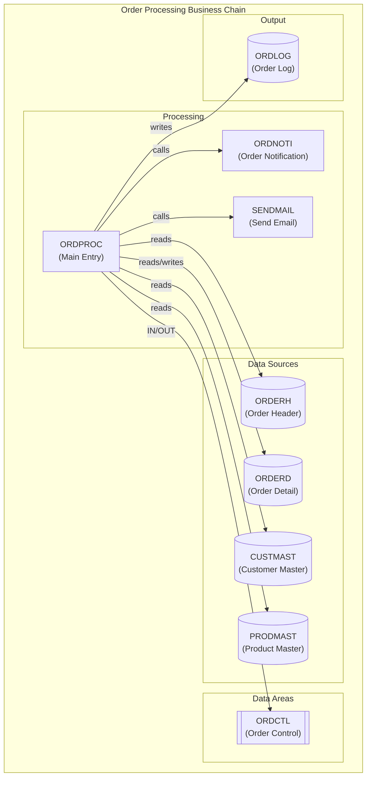
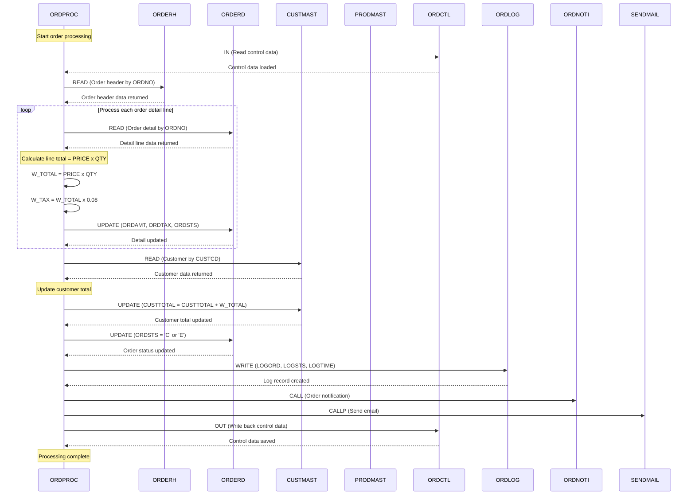
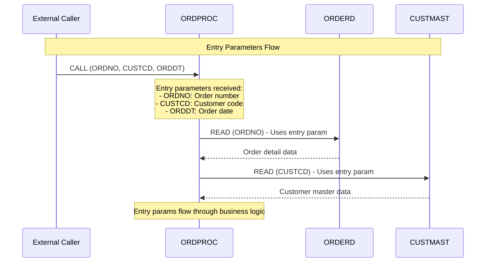
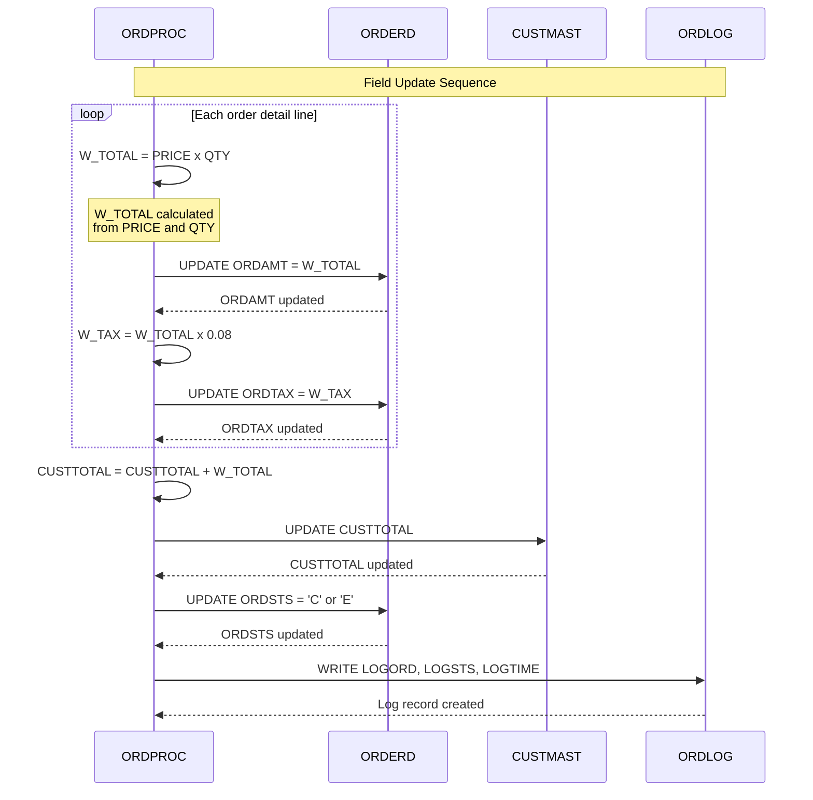

<!-- 创建时间: 2026-09-14 10:30 -->
<!-- 最后修改: 2026-09-14 10:30 -->

# IBM i 程序分析 HTML 报告系统 - 功能设计文档

## 1. 系统概述

### 1.1 设计目标

基于已有的 JSON 事实文件（记录程序逻辑、字段、关联表/DataArea、调用关系等），生成一套**交互式 HTML 报告**，用于展示 IBM i 程序的业务链路、程序流程、数据流向和对象详情。

### 1.2 核心设计原则

| 原则 | 说明 |
|------|------|
| **关注点分离** | Summary、子业务链、对象详情分别独立 HTML，避免单文件过大 |
| **业务语言优先** | 流程图和时序图使用业务语言描述，英文 |
| **交互式探索** | 鼠标悬停显示对象摘要，点击跳转到详细说明 |
| **JSON 驱动** | 所有报告内容从 JSON 事实文件自动提取，无硬编码 |
| **可离线查看** | 所有资源内联或相对路径，无需服务器 |

---

## 2. HTML 文件组织结构

```
reports/
├── index.html                          # 入口：Summary 总览页面
├── css/
│   └── report.css                      # 全局样式
├── js/
│   ├── common.js                       # 公共函数（悬停、浮窗、导航）
│   ├── mermaid.min.js                  # Mermaid 流程图库
│   └── data-loader.js                  # JSON 数据加载器
├── sub-chain/
│   ├── SP-01-{business-name}.html      # 子业务链 1 详情页
│   ├── SP-02-{business-name}.html      # 子业务链 2 详情页
│   └── ...
├── objects/
│   ├── PRG-{program-name}.html         # 程序详情页
│   ├── FILE-{file-name}.html           # 文件/表详情页
│   ├── DTAARA-{area-name}.html         # DataArea 详情页
│   └── ...
└── data/
    ├── manifest.json                   # 报告清单（所有子业务链和对象的索引）
    ├── sub-chain-SP-01.json            # 子业务链 1 的数据（从多个程序 JSON 聚合）
    ├── sub-chain-SP-02.json            # 子业务链 2 的数据
    └── ...
```

### 2.1 文件职责

| 文件类型 | 职责 | 数据来源 |
|---------|------|---------|
| `index.html` | 报告入口，展示主业务链 Summary | 聚合所有子业务链 JSON |
| `sub-chain/SP-XX-*.html` | 单个子业务链的详细展示 | 对应子业务链 JSON |
| `objects/PRG-*.html` | 单个程序的详细说明 | 单个程序 JSON |
| `objects/FILE-*.html` | 单个文件/表的详细说明 | 从多个程序 JSON 中提取该文件的信息 |
| `objects/DTAARA-*.html` | 单个 DataArea 的详细说明 | 从多个程序 JSON 中提取该 DataArea 的信息 |
| `data/manifest.json` | 索引文件，记录所有报告的元数据 | 构建时生成 |

---

## 3. 数据模型：manifest.json

报告系统的索引文件，用于导航和数据加载：

```json
{
  "report_meta": {
    "entry_program": "ORDPROC",
    "generated_at": "2026-09-14T10:30:00",
    "total_programs": 5,
    "total_files": 8,
    "total_data_areas": 2
  },
  "sub_chains": [
    {
      "id": "SP-01",
      "name": "Order Processing",
      "entry_program": "ORDPROC",
      "programs": ["ORDPROC", "ORDNOTI", "SENDMAIL"],
      "data_file": "data/sub-chain-SP-01.json",
      "html_file": "sub-chain/SP-01-Order-Processing.html"
    }
  ],
  "objects": {
    "programs": [
      {
        "name": "ORDPROC",
        "type": "RPGLE",
        "html_file": "objects/PRG-ORDPROC.html",
        "part_of_chains": ["SP-01"]
      }
    ],
    "files": [
      {
        "name": "ORDERH",
        "type": "Physical File",
        "html_file": "objects/FILE-ORDERH.html",
        "accessed_by": ["ORDPROC"]
      }
    ],
    "data_areas": [
      {
        "name": "ORDCTL",
        "html_file": "objects/DTAARA-ORDCTL.html",
        "accessed_by": ["ORDPROC"]
      }
    ]
  }
}
```

---

## 4. Summary 页面（index.html）内容结构

### 4.1 页面布局

```
+==============================================================================+
|  [Header] IBM i Business Chain Analysis Report                               |
|  Entry Program: ORDPROC                          Generated: 2026-09-14       |
+==============================================================================+
|                                                                              |
|  [Section 1: Business Overview]                                              |
|  +------------------------------------------------------------------------+  |
|  | 业务介绍：一段文字描述该程序的核心业务目的、触发条件、主要处理逻辑           |  |
|  | 关键指标：程序数 | 文件数 | DataArea数 | 业务分支数                        |  |
|  +------------------------------------------------------------------------+  |
|                                                                              |
|  [Section 2: Main Business Chain Flowchart]                                  |
|  +------------------------------------------------------------------------+  |
|  |  [Mermaid flowchart TD]                                                  |  |
|  |  完整的主业务链程序流程图，包含：                                           |  |
|  |  - 所有程序节点（可悬停、可点击）                                          |  |
|  |  - 所有文件/表节点（可悬停、可点击）                                       |  |
|  |  - 所有 DataArea 节点（可悬停、可点击）                                    |  |
|  |  - 节点间的调用关系和数据流向                                              |  |
|  +------------------------------------------------------------------------+  |
|                                                                              |
|  [Section 3: Business Sequence Diagram]                                      |
|  +------------------------------------------------------------------------+  |
|  |  [Mermaid sequenceDiagram]                                               |  |
|  |  主业务链的时序图，展示：                                                  |  |
|  |  - 程序间的调用时序                                                       |  |
|  |  - 数据在程序间的流动                                                     |  |
|  +------------------------------------------------------------------------+  |
|                                                                              |
|  [Section 4: Sub-Business Chain Overview]                                    |
|  +------------------------------------------------------------------------+  |
|  | 子业务链列表：                                                            |  |
|  | | ID | 名称 | 入口程序 | 程序数 | 详情链接 |                               |  |
|  | |----|------|---------|-------|---------|                               |  |
|  | | SP-01 | Order Processing | ORDPROC | 3 | [View Details] |             |  |
|  +------------------------------------------------------------------------+  |
|                                                                              |
|  [Section 5: Object Index]                                                   |
|  +------------------------------------------------------------------------+  |
|  | 程序索引：可搜索、可过滤的程序列表，点击跳转到程序详情                       |  |
|  | 文件索引：可搜索、可过滤的文件列表，点击跳转到文件详情                       |  |
|  | DataArea索引：可搜索、可过滤的DataArea列表，点击跳转到详情                  |  |
|  +------------------------------------------------------------------------+  |
|                                                                              |
+==============================================================================+
```

### 4.2 主业务链流程图规范

**节点类型和样式**：

| 节点类型 | Mermaid 表示 | 样式 | 说明 |
|---------|-------------|------|------|
| 程序 | `PRG["Program Name"]` | 矩形，蓝色边框 | 可悬停显示程序摘要，点击跳转到程序详情 |
| 文件/表 | `FILE[("File/Table Name")]` | 圆柱体，绿色边框 | 可悬停显示文件摘要，点击跳转到文件详情 |
| DataArea | `DTAARA[["DataArea Name"]]` | 双括号，橙色边框 | 可悬停显示DataArea摘要，点击跳转到详情 |
| 调用关系 | `PRG1 -->|calls| PRG2` | 箭头线，标注调用类型 | 悬停显示调用参数 |
| 数据流向 | `FILE -->|reads/writes| PRG` | 箭头线，标注操作类型 | 悬停显示操作的字段 |

**Mermaid 流程图示例**：



### 4.3 主业务链时序图规范

**时序图元素**：

| 元素类型 | 表示方式 | 说明 |
|---------|---------|------|
| 参与者（程序） | `participant "ORDPROC" as PRG` | 程序作为时序图参与者 |
| 数据存储（文件） | `participant "ORDERH" as FILE` | 文件作为时序图参与者 |
| DataArea | `participant "ORDCTL" as DTAARA` | DataArea作为时序图参与者 |
| 调用消息 | `PRG->>FILE: READ (field1, field2)` | 程序读取文件字段 |
| 返回消息 | `FILE-->>PRG: record data` | 文件返回数据 |
| 写入消息 | `PRG->>FILE: WRITE (field1=expr)` | 程序写入文件字段 |
| 备注 | `Note over PRG: business description` | 业务语言描述 |

**Mermaid 时序图示例**：



---

## 5. 子业务链页面（sub-chain/SP-XX-*.html）内容结构

### 5.1 页面布局

```
+==============================================================================+
|  [Header] Sub-Business Chain: Order Processing                               |
|  Entry Program: ORDPROC            Chain ID: SP-01                           |
+==============================================================================+
|  [Breadcrumb] Summary > SP-01: Order Processing                              |
+==============================================================================+
|                                                                              |
|  [Section 1: Business Overview]                                              |
|  +------------------------------------------------------------------------+  |
|  | 该子业务链的业务介绍：核心目的、触发条件、处理流程概述                       |  |
|  | 涉及的程序列表（可点击跳转到程序详情）                                     |  |
|  +------------------------------------------------------------------------+  |
|                                                                              |
|  [Section 2: Program Flowchart]                                              |
|  +------------------------------------------------------------------------+  |
|  |  [Mermaid flowchart TD]                                                  |  |
|  |  该子业务链的程序流程图，颗粒度与Summary一致                               |  |
|  |  - 包含所有程序、文件、DataArea节点                                       |  |
|  |  - 节点可悬停、可点击                                                    |  |
|  +------------------------------------------------------------------------+  |
|                                                                              |
|  [Section 3: Sequence Diagram - Business Flow]                               |
|  +------------------------------------------------------------------------+  |
|  |  [Mermaid sequenceDiagram]                                               |  |
|  |  该子业务链的业务时序图，展示程序间的完整交互                               |  |
|  +------------------------------------------------------------------------+  |
|                                                                              |
|  [Section 4: Entry Parameters & Updated Fields Sequence]                     |
|  +------------------------------------------------------------------------+  |
|  |  [Mermaid sequenceDiagram]                                               |  |
|  |  入口参数字段的时序图：                                                   |  |
|  |  - 展示入口参数如何传入各个程序                                           |  |
|  |  - 展示参数在各程序中的使用和变换                                         |  |
|  |  有表更新的字段时序图：                                                   |  |
|  |  - 展示哪些字段被写入哪些表                                               |  |
|  |  - 展示字段更新的时序和条件                                               |  |
|  +------------------------------------------------------------------------+  |
|                                                                              |
|  [Section 5: Field Propagation Chains]                                       |
|  +------------------------------------------------------------------------+  |
|  |  字段传递链路表格：                                                       |  |
|  |  | Source | Target | Expression | Conditions | Line |                     |  |
|  |  从JSON的field_chains提取，使用业务语言描述                                |  |
|  +------------------------------------------------------------------------+  |
|                                                                              |
|  [Section 6: Program Details]                                                |
|  +------------------------------------------------------------------------+  |
|  |  每个程序的详细信息卡片：                                                 |  |
|  |  - 程序概览表格（类型、入口、文件、调用等）                                |  |
|  |  - 业务逻辑表格（计算公式、业务规则、常量）                                |  |
|  |  - 表操作表格（字段、操作、表达式、条件）                                  |  |
|  |  [View Full Details →] 链接到程序详情页                                   |  |
|  +------------------------------------------------------------------------+  |
|                                                                              |
+==============================================================================+
```

### 5.2 入口参数字段时序图



### 5.3 有表更新的字段时序图



---

## 6. 程序详情页面（objects/PRG-*.html）内容结构

### 6.1 页面布局

```
+==============================================================================+
|  [Header] Program: ORDPROC                                                   |
|  Type: RPGLE                    Library: QRPGLESRC                           |
+==============================================================================+
|  [Breadcrumb] Summary > SP-01 > ORDPROC                                      |
+==============================================================================+
|                                                                              |
|  [Section 1: Program Overview]                                               |
|  +------------------------------------------------------------------------+  |
|  | | Item | Value |                                                         |  |
|  | |------|-------|                                                         |  |
|  | | Program Name | ORDPROC |                                               |  |
|  | | Type | RPGLE |                                                         |  |
|  | | Entry Points | MAIN (Line 2) |                                         |  |
|  | | Files | 5 (ORDERH, ORDERD, CUSTMAST, PRODMAST, ORDLOG) |               |  |
|  | | Data Areas | 1 (ORDCTL) |                                              |  |
|  | | Program Calls | 2 (ORDNOTI, SENDMAIL) |                                |  |
|  | | COPY/INCLUDE | 2 (INITSRV, UTIL_H) |                                   |  |
|  +------------------------------------------------------------------------+  |
|                                                                              |
|  [Section 2: Program Flowchart]                                              |
|  +------------------------------------------------------------------------+  |
|  |  [Mermaid flowchart TD]                                                  |  |
|  |  该程序的完整流程图，包含所有步骤和条件分支                                 |  |
|  +------------------------------------------------------------------------+  |
|                                                                              |
|  [Section 3: Business Logic]                                                 |
|  +------------------------------------------------------------------------+  |
|  | [Tab: Calculations]                                                      |  |
|  | | Formula | Expression | Condition | Line |                              |  |
|  |                                                                         |  |
|  | [Tab: Business Rules]                                                    |  |
|  | | Rule | Condition | Action | Line |                                     |  |
|  |                                                                         |  |
|  | [Tab: Constants]                                                         |  |
|  | | Constant | Value | Usage | Line |                                      |  |
|  +------------------------------------------------------------------------+  |
|                                                                              |
|  [Section 4: Data Dictionary]                                                |
|  +------------------------------------------------------------------------+  |
|  |  可搜索、可过滤的字段表格                                                  |  |
|  |  | Field | Type | Source | Business Meaning | Line |                     |  |
|  +------------------------------------------------------------------------+  |
|                                                                              |
|  [Section 5: File Operations]                                                |
|  +------------------------------------------------------------------------+  |
|  |  每个文件的操作详情                                                       |  |
|  |  [File: ORDERH (INPUT)]                                                  |  |
|  |  | Field | Operation | Expression | Condition | Written | Line |         |  |
|  |  [File: ORDERD (INPUT/OUTPUT)]                                           |  |
|  |  | Field | Operation | Expression | Condition | Written | Line |         |  |
|  +------------------------------------------------------------------------+  |
|                                                                              |
|  [Section 6: Data Area]                                                      |
|  +------------------------------------------------------------------------+  |
|  |  DataArea详情表格                                                        |  |
|  |  | Area Name | Operation | Data Type | Length | Line |                   |  |
|  +------------------------------------------------------------------------+  |
|                                                                              |
|  [Section 7: Field Propagation Chains]                                       |
|  +------------------------------------------------------------------------+  |
|  |  字段传递链路的可视化展示                                                 |  |
|  |  从源字段到目标字段的完整传递路径                                         |  |
|  +------------------------------------------------------------------------+  |
|                                                                              |
+==============================================================================+
```

---

## 7. 文件/表详情页面（objects/FILE-*.html）内容结构

### 7.1 页面布局

```
+==============================================================================+
|  [Header] File/Table: ORDERD                                                 |
|  Type: Physical File           Usage: INPUT/OUTPUT                           |
+==============================================================================+
|  [Breadcrumb] Summary > ORDERD                                               |
+==============================================================================+
|                                                                              |
|  [Section 1: File Overview]                                                  |
|  +------------------------------------------------------------------------+  |
|  | | Item | Value |                                                         |  |
|  | |------|-------|                                                         |  |
|  | | File Name | ORDERD |                                                   |  |
|  | | Type | Physical File |                                                 |  |
|  | | Usage | INPUT/OUTPUT |                                                 |  |
|  | | Accessed By | ORDPROC |                                                |  |
|  +------------------------------------------------------------------------+  |
|                                                                              |
|  [Section 2: Field Operations]                                               |
|  +------------------------------------------------------------------------+  |
|  |  该文件中所有字段的操作详情                                               |  |
|  |  | Field | Operation | Expression | Condition | Written | Line |         |  |
|  |  数据来源：所有访问该文件的程序的JSON中的field_operations                  |  |
|  +------------------------------------------------------------------------+  |
|                                                                              |
|  [Section 3: Field Propagation Chains]                                       |
|  +------------------------------------------------------------------------+  |
|  |  该文件相关的字段传递链路                                                 |  |
|  |  从源字段到该文件字段的完整传递路径                                       |  |
|  +------------------------------------------------------------------------+  |
|                                                                              |
|  [Section 4: Access Patterns]                                                |
|  +------------------------------------------------------------------------+  |
|  |  展示哪些程序在什么条件下访问该文件                                       |  |
|  |  | Program | Operation | Condition | Line |                              |  |
|  +------------------------------------------------------------------------+  |
|                                                                              |
+==============================================================================+
```

---

## 8. DataArea 详情页面（objects/DTAARA-*.html）内容结构

### 8.1 页面布局

```
+==============================================================================+
|  [Header] DataArea: ORDCTL                                                   |
|  Type: *CHAR                   Length: 200                                   |
+==============================================================================+
|  [Breadcrumb] Summary > ORDCTL                                               |
+==============================================================================+
|                                                                              |
|  [Section 1: DataArea Overview]                                              |
|  +------------------------------------------------------------------------+  |
|  | | Item | Value |                                                         |  |
|  | |------|-------|                                                         |  |
|  | | Area Name | ORDCTL |                                                   |  |
|  | | Type | *CHAR |                                                         |  |
|  | | Length | 200 |                                                         |  |
|  | | Accessed By | ORDPROC |                                                |  |
|  +------------------------------------------------------------------------+  |
|                                                                              |
|  [Section 2: References]                                                     |
|  +------------------------------------------------------------------------+  |
|  |  所有引用该DataArea的操作                                                 |  |
|  |  | Program | Operation | Line | Raw Statement |                          |  |
|  |  |---------|-----------|------|---------------|                          |  |
|  |  | ORDPROC | DEFINE | 18 | DCL-DTAARA ORDCTL TYPE(*CHAR) LEN(200) |    |  |
|  |  | ORDPROC | IN | 44 | IN ORDCTL; |                                      |  |
|  |  | ORDPROC | OUT | 112 | OUT ORDCTL; |                                   |  |
|  +------------------------------------------------------------------------+  |
|                                                                              |
|  [Section 3: Data Structure Fields]                                          |
|  +------------------------------------------------------------------------+  |
|  |  DataArea中的DS字段拆解                                                   |  |
|  |  DS Name: ORDCTL_DS                                                      |  |
|  |  | Field | Default Value | Line |                                         |  |
|  |  |-------|---------------|------|                                         |  |
|  |  | COUNTER | ORDCTL_DS.COUNTER + 1 | 45 |                                |  |
|  |  | CUSTOMER_CODE | CUSTCD | 45 |                                         |  |
|  |  | ERROR_FLAG | 'Y' | 45 |                                              |  |
|  |  | ORDER_DATE | ORDDT | 45 |                                             |  |
|  +------------------------------------------------------------------------+  |
|                                                                              |
+==============================================================================+
```

---

## 9. 交互功能设计

### 9.1 鼠标悬停功能

**实现方式**：CSS Tooltip + JavaScript 事件监听

**悬停显示内容**：

| 对象类型 | 悬停显示的摘要信息 |
|---------|------------------|
| 程序 | 程序名、类型、文件数、调用数、一句话业务描述 |
| 文件/表 | 文件名、类型、访问模式、操作字段数、一句话用途描述 |
| DataArea | DataArea名、类型、长度、引用次数、一句话用途描述 |

**CSS Tooltip 样式**：

```css
.tooltip {
    position: absolute;
    background: #fff;
    border: 1px solid #ccc;
    border-radius: 4px;
    padding: 8px 12px;
    box-shadow: 0 2px 8px rgba(0,0,0,0.15);
    max-width: 300px;
    z-index: 1000;
    pointer-events: none;
}

.tooltip .tooltip-title {
    font-weight: bold;
    color: #1a73e8;
    margin-bottom: 4px;
}

.tooltip .tooltip-type {
    font-size: 0.85em;
    color: #666;
    margin-bottom: 6px;
}

.tooltip .tooltip-desc {
    font-size: 0.9em;
    color: #333;
}
```

**Mermaid 图表中的悬停实现**：

由于 Mermaid 生成的 SVG 不直接支持原生 tooltip，需要：
1. 为 Mermaid 节点添加自定义 `data-*` 属性
2. 使用 JavaScript 监听 Mermaid 节点的 `mouseenter`/`mouseleave` 事件
3. 动态创建和定位 tooltip 元素

### 9.2 鼠标点击跳转功能

**实现方式**：Mermaid 节点点击事件 + 页面跳转或浮窗

**点击行为**：

| 触发条件 | 行为 |
|---------|------|
| 点击程序节点 | 跳转到 `objects/PRG-{name}.html` 或打开浮窗 |
| 点击文件节点 | 跳转到 `objects/FILE-{name}.html` 或打开浮窗 |
| 点击 DataArea 节点 | 跳转到 `objects/DTAARA-{name}.html` 或打开浮窗 |
| 点击子业务链链接 | 跳转到 `sub-chain/SP-XX-{name}.html` |

**浮窗卡片设计**：

```html
<div class="detail-card" id="detailCard">
    <div class="card-header">
        <h3 class="card-title">ORDPROC</h3>
        <button class="card-close" onclick="closeCard()">&times;</button>
    </div>
    <div class="card-body">
        <div class="card-tabs">
            <button class="tab-btn active" data-tab="overview">Overview</button>
            <button class="tab-btn" data-tab="files">Files</button>
            <button class="tab-btn" data-tab="calls">Calls</button>
        </div>
        <div class="tab-content" id="overview">
            <table class="card-table">
                <tr><td>Type</td><td>RPGLE</td></tr>
                <tr><td>Files</td><td>5</td></tr>
                <tr><td>Calls</td><td>2</td></tr>
            </table>
        </div>
    </div>
    <div class="card-footer">
        <a href="objects/PRG-ORDPROC.html" class="card-link">View Full Details →</a>
    </div>
</div>
```

### 9.3 浮窗卡片样式

```css
.detail-card {
    position: fixed;
    top: 50%;
    left: 50%;
    transform: translate(-50%, -50%);
    width: 500px;
    max-height: 80vh;
    background: #fff;
    border-radius: 8px;
    box-shadow: 0 4px 20px rgba(0,0,0,0.25);
    z-index: 2000;
    overflow: hidden;
}

.card-header {
    display: flex;
    justify-content: space-between;
    align-items: center;
    padding: 12px 16px;
    background: #f8f9fa;
    border-bottom: 1px solid #e0e0e0;
}

.card-body {
    padding: 16px;
    overflow-y: auto;
    max-height: 60vh;
}

.card-footer {
    padding: 12px 16px;
    background: #f8f9fa;
    border-top: 1px solid #e0e0e0;
    text-align: right;
}
```

---

## 10. 流程图和时序图的业务语言规范

### 10.1 业务语言描述规则

| 规则 | 说明 | 示例 |
|------|------|------|
| 使用业务术语 | 用业务概念代替技术实现 | "Order Processing" 而非 "Main Loop" |
| 英文描述 | 所有描述使用英文 | "Calculate order total" |
| 包含目的 | 说明操作的业务目的 | "Validate customer credit" |
| 包含条件 | 说明触发条件 | "If customer is VIP" |
| 避免代码细节 | 不使用 RPG/COBOL 语法 | "Set status to completed" 而非 "EVAL ORDSTS = 'C'" |

### 10.2 节点命名规范

| 节点类型 | 命名格式 | 示例 |
|---------|---------|------|
| 程序 | `"{Program Name}<br/>({Business Purpose})"` | `"ORDPROC<br/>(Order Processing)"` |
| 文件/表 | `"{File Name}<br/>({Business Purpose})"` | `"ORDERD<br/>(Order Detail)"` |
| DataArea | `"{Area Name}<br/>({Business Purpose})"` | `"ORDCTL<br/>(Order Control)"` |

### 10.3 边标注规范

| 操作类型 | 标注格式 | 示例 |
|---------|---------|------|
| 程序调用 | `"calls"` | `PRG1 -->|calls| PRG2` |
| 读取数据 | `"reads"` | `PRG -->|reads| FILE` |
| 写入数据 | `"writes"` | `PRG -->|writes| FILE` |
| 读写数据 | `"reads/writes"` | `PRG -->|reads/writes| FILE` |
| IN DataArea | `"IN"` | `PRG -->|IN| DTAARA` |
| OUT DataArea | `"OUT"` | `PRG -->|OUT| DTAARA` |

---

## 11. 从 JSON 到 HTML 的数据转换流程

### 11.1 数据聚合流程

```
Step 1: 读取入口程序的 JSON
        ↓
Step 2: 从 program_calls 提取调用的程序列表
        ↓
Step 3: 递归读取每个被调用程序的 JSON
        ↓
Step 4: 构建完整的调用树（Call Tree）
        ↓
Step 5: 识别业务分支（从入口程序的不同调用路径）
        ↓
Step 6: 为每个业务分支创建子业务链数据
        ↓
Step 7: 提取所有文件和 DataArea 的信息
        ↓
Step 8: 生成 manifest.json
        ↓
Step 9: 生成各个 HTML 页面
```

### 11.2 业务链分支识别逻辑

从入口程序的 `program_calls` 字段开始，根据调用路径的分叉识别业务分支：

```
ORDPROC (Entry)
├── CALL ORDNOTI (Branch 1: Notification)
│   └── CALLP SENDMAIL (Sub-branch: Email)
└── [其他调用路径] (Branch 2: ...)
```

### 11.3 业务语言描述生成规则

| JSON 字段 | 业务语言转换规则 |
|-----------|----------------|
| `program_calls[].program` | "Call {program} to handle {inferred purpose}" |
| `file_refs[].name` | "Access {file} for {inferred purpose}" |
| `field_operations` | "Update {field} in {file} with {expression}" |
| `data_areas[].refs[]` | "{operation} control data from {area}" |
| `field_chains[]` | "Propagate {source} to {target} via {expression}" |

---

## 12. 响应式设计

### 12.1 断点定义

| 断点 | 宽度范围 | 布局调整 |
|------|---------|---------|
| Desktop | ≥ 1200px | 完整布局，侧边导航 |
| Tablet | 768px - 1199px | 简化布局，折叠导航 |
| Mobile | < 768px | 单列布局，底部导航 |

### 12.2 Mermaid 图表响应式

- Desktop：完整显示流程图和时序图
- Tablet：自动缩放，支持平移和缩放
- Mobile：提供"展开查看"按钮，点击后全屏显示图表

---

## 13. 优化建议

### 13.1 建议一：增加"业务术语表"

在 Summary 页面增加一个 Business Glossary 部分，列出报告中使用的所有业务术语及其技术对应物：

| Business Term | Technical Term | Description |
|--------------|----------------|-------------|
| Order Header | ORDERH file | Stores order header information |
| Order Detail | ORDERD file | Stores order line items |
| Customer Master | CUSTMAST file | Stores customer information |
| Order Control | ORDCTL DataArea | Stores order processing control data |

### 13.2 建议二：增加"数据流向矩阵"

在 Summary 页面增加一个数据流向矩阵，以表格形式展示所有程序和文件的交互关系：

| | ORDERH | ORDERD | CUSTMAST | PRODMAST | ORDLOG |
|---|--------|--------|----------|----------|--------|
| ORDPROC | R | R/W | R | R | W |
| ORDNOTI | R | - | R | - | - |
| SENDMAIL | - | - | - | - | - |

（R=Read, W=Write, R/W=Read+Write）

### 13.3 建议三：增加"变更影响分析"视图

基于字段传递链路，提供"如果修改字段 X，会影响哪些程序和文件"的分析视图：

```
If you modify field PRICE:
├── ORDPROC (reads PRICE)
│   ├── ORDERD.W_TOTAL (calculated from PRICE × QTY)
│   ├── ORDERD.ORDTAX (calculated from W_TOTAL × 0.08)
│   └── CUSTMAST.CUSTTOTAL (accumulated from W_TOTAL)
└── ...
```

### 13.4 建议四：增加"搜索和过滤"功能

在所有列表页面（程序索引、文件索引、字段表格等）增加：
- 实时搜索框
- 按类型过滤
- 按程序/文件过滤
- 按操作类型过滤（READ/WRITE/UPDATE）

### 13.5 建议五：增加"打印/导出"功能

- PDF 导出（使用浏览器打印功能）
- Markdown 导出（将 HTML 内容转换为 Markdown）
- PNG 导出（将 Mermaid 图表导出为图片）

### 13.6 建议六：增加"版本对比"功能

如果有多个版本的 JSON 文件，可以对比不同版本的业务链变化：
- 新增/删除的程序
- 新增/删除的文件
- 修改的字段传递链路

---

## 14. 技术实现建议

### 14.1 技术栈

| 组件 | 推荐技术 | 说明 |
|------|---------|------|
| 流程图 | Mermaid.js | 轻量级，支持 flowchart 和 sequenceDiagram |
| 样式 | Bootstrap 5 或 Tailwind CSS | 响应式布局 |
| 交互 | 原生 JavaScript | 无需框架依赖 |
| 数据 | JSON 文件 | 通过 fetch 加载 |
| 构建 | Python/Node.js 脚本 | 从 JSON 生成 HTML |

### 14.2 构建脚本功能

构建脚本（Python 或 Node.js）需要实现：

1. **读取入口程序 JSON**：获取起始点
2. **递归追踪调用链**：从 `program_calls` 构建调用树
3. **识别业务分支**：根据调用路径分叉
4. **聚合数据**：为每个子业务链聚合相关程序的数据
5. **提取对象信息**：提取所有文件和 DataArea 的信息
6. **生成 manifest.json**：创建报告索引
7. **生成 HTML 页面**：使用模板引擎生成各个 HTML 文件

### 14.3 Mermaid 配置

```javascript
mermaid.initialize({
    startOnLoad: false,
    theme: 'default',
    flowchart: {
        useMaxWidth: true,
        htmlLabels: true,
        curve: 'basis'
    },
    sequence: {
        useMaxWidth: true,
        showSequenceNumbers: true
    }
});
```

---

## 15. 总结

### 15.1 文件清单

| 文件类型 | 数量 | 说明 |
|---------|------|------|
| Summary 页面 | 1 | index.html |
| 子业务链页面 | N | 每个业务分支一个 |
| 程序详情页面 | M | 每个程序一个 |
| 文件详情页面 | K | 每个文件/表一个 |
| DataArea 详情页面 | L | 每个 DataArea 一个 |
| 样式文件 | 1 | report.css |
| JavaScript 文件 | 3 | common.js, mermaid.min.js, data-loader.js |
| 数据文件 | N+1 | manifest.json + 每个子业务链的 JSON |

### 15.2 关键特性

1. **模块化**：Summary、子业务链、对象详情分离，避免单文件过大
2. **交互式**：鼠标悬停显示摘要，点击跳转到详情或打开浮窗
3. **业务语言**：所有描述使用业务术语，英文
4. **可视化**：使用 Mermaid 生成流程图和时序图
5. **可搜索**：支持搜索和过滤功能
6. **响应式**：支持 Desktop、Tablet、Mobile
7. **可离线**：所有资源相对路径，无需服务器

---

【功能设计文档已完成。请确认以上设计是否符合需求？回复"确认"继续，或提出修改意见。】
