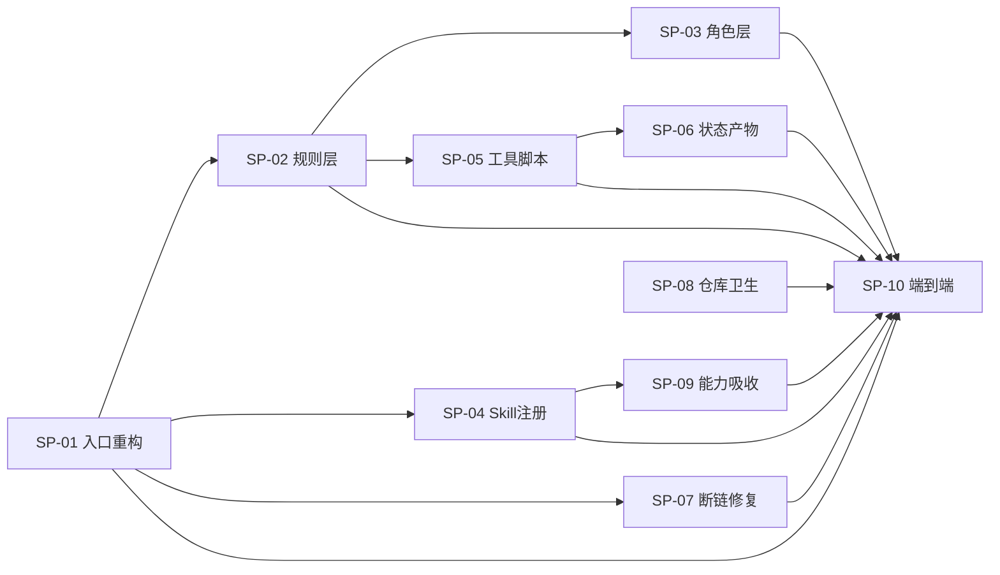

<!-- 创建时间: 2026-10-30 20:55 -->
<!-- 最后修改: 2026-10-30 20:55 -->

# 全局执行计划概览（轻量）

> 任务：T2026-1030-01 · AI Team 流程整改（L3）
> 蓝图：`agent-doc/result-first/2026-10-30-01-agent流程整改-result-blueprint.md`
> 说明：本文件只定义任务清单、依赖与负责人，详细执行步骤见各独立子计划文件。

---

## 1. 任务清单与依赖

| 任务 | 名称 | 对应蓝图项 | 前置依赖 | 负责 Agent | 技术栈 |
|------|------|-----------|---------|-----------|--------|
| SP-01 | 规则入口重构与模板拆出 | F01、F13、M1、M5、R-HR-01、R-HR-09 | 无 | PM + doc-output | doc |
| SP-02 | 规则层重写与编号治理 | F02–F06、R-HR-01..10、R-LV、R-ST、R-PM | SP-01 | PM + doc-output | doc |
| SP-03 | 角色层收敛（4 个 Agent） | F07–F10、API-002..007/011、R-HR-03/04 | SP-02 | PM + doc-output | doc |
| SP-04 | Skill 注册表与 frontmatter | F11、F12、M4、API-008、D6、R-HR-07 | SP-01 | PM + Skill Creator | doc |
| SP-05 | 工具脚本 5 个 | T1–T5、M7、API-012、D3/D5 | SP-02 | code-dev(tools) | python |
| SP-06 | 任务状态产物落地 | F14、M6、D1/D2/D5、API-010、R-HR-06 | SP-05 | PM | doc + json |
| SP-07 | 断链修复（24 处） | F15、P0-01、P0-02、P1-09 | SP-01 | PM | doc |
| SP-08 | 仓库卫生 | F16、P2-02 | 无 | PM | repo |
| SP-09 | 能力吸收流程与回归用例 | F17、API-009、D7/D8、R-HR-10、S8 | SP-04 | Skill Creator | doc |
| SP-10 | 元审计与端到端验证 | G1–G5、S5/S6/S7、R-HR-03/04/05 | SP-01–SP-09 | 核查 + 稽查 | 全栈 |

## 2. 任务依赖图

## 3. 里程碑与排期

| 里程碑 | 阶段 | 包含任务 | 工作量估算 | 关键路径 |
|--------|------|---------|-----------|---------|
| M1 | 规则骨架就位 | SP-01、SP-02 | 1.0 人天 | SP-01 → SP-02 |
| M2 | 工具与状态可跑 | SP-05、SP-06 | 1.0 人天 | SP-02 → SP-05 → SP-06 |
| M3 | 角色与技能对齐 | SP-03、SP-04 | 0.5 人天 | SP-02 → SP-03；SP-01 → SP-04 |
| M4 | 治理闭环 | SP-07、SP-08、SP-09 | 0.5 人天 | SP-04 → SP-09 |
| M5 | 端到端验证 | SP-10 | 0.5 人天 | 全部前置 |

总估算：3.5 人天。

## 4. 任务→技术栈分配

| 任务 | 技术栈 | 子 Agent |
|------|--------|---------|
| SP-01、SP-02、SP-03、SP-06、SP-07、SP-08 | 文档/仓库 | PM（doc-output 协同） |
| SP-04、SP-09 | Skill 资产 | Skill Creator Agent |
| SP-05 | Python 脚本 | code-dev → tools 分支（ADR-007） |
| SP-10 | 全栈验证 | 核查 Agent + 稽查 Agent |

## 5. 独立子计划文件清单

| 文件 | 类型 | 技术栈 | 对应蓝图章节 | 前置依赖 |
|------|------|--------|-------------|---------|
| `SP-01-规则入口重构与模板拆出.md` | A | doc | M1/M5、F01/F13、R-HR-01/09 | 无 |
| `SP-02-规则层重写与编号治理.md` | A | doc | R-HR-01..10、R-LV/R-ST/R-PM、F02–F06 | SP-01 |
| `SP-03-角色层收敛.md` | A | doc | M3、API-002..007/011、F07–F10 | SP-02 |
| `SP-04-Skill注册表与frontmatter.md` | A | doc | M4、API-008、D6、F11/F12 | SP-01 |
| `SP-05-工具脚本实现.md` | B | python | T1–T5、API-012、D3/D5 | SP-02 |
| `SP-06-任务状态产物落地.md` | A | doc+json | M6、D1/D2/D5、API-010、F14 | SP-05 |
| `SP-07-断链修复.md` | A | doc | F15、P0-01/P0-02/P1-09 | SP-01 |
| `SP-08-仓库卫生.md` | A | repo | F16、P2-02 | 无 |
| `SP-09-能力吸收流程与回归用例.md` | A | doc | F17、API-009、D7/D8、R-HR-10 | SP-04 |
| `SP-10-元审计与端到端验证.md` | C | 全栈 | G1–G5、S5/S6/S7 | SP-01–SP-09 |

## 6. 风险与应对

| 风险 | 影响 | 应对 |
|------|------|------|
| SP-01 拆分后 AGENTS.md 丢失门禁规则 | 流程失效 | 迁移后逐条比对 R-HR-01..10 是否仍可检索 |
| SP-05 脚本与 SP-02 schema 不一致 | 关卡判定失败 | 以 SP-02 的 D5 schema 为唯一契约，脚本先行写测试 |
| SP-07 断链替换遗漏 | 稽查依据悬空 | `link_check.py` 退出码必须 0 |
| 旧产出物引用旧路径 | 阅读混乱 | 仅在文档头部标注"历史产出，路径已迁移"，不删历史 |
| 整改期间自身流程被执行 | 状态污染 | 本任务状态存于 `agent-doc/tasks/T2026-1030-01/` |

## 7. 覆盖核查触发

已通知核查 Agent 执行"蓝图→子计划覆盖核查"，报告见 `agent-doc/plan/2026-10-30/verification-coverage-report.md`。
