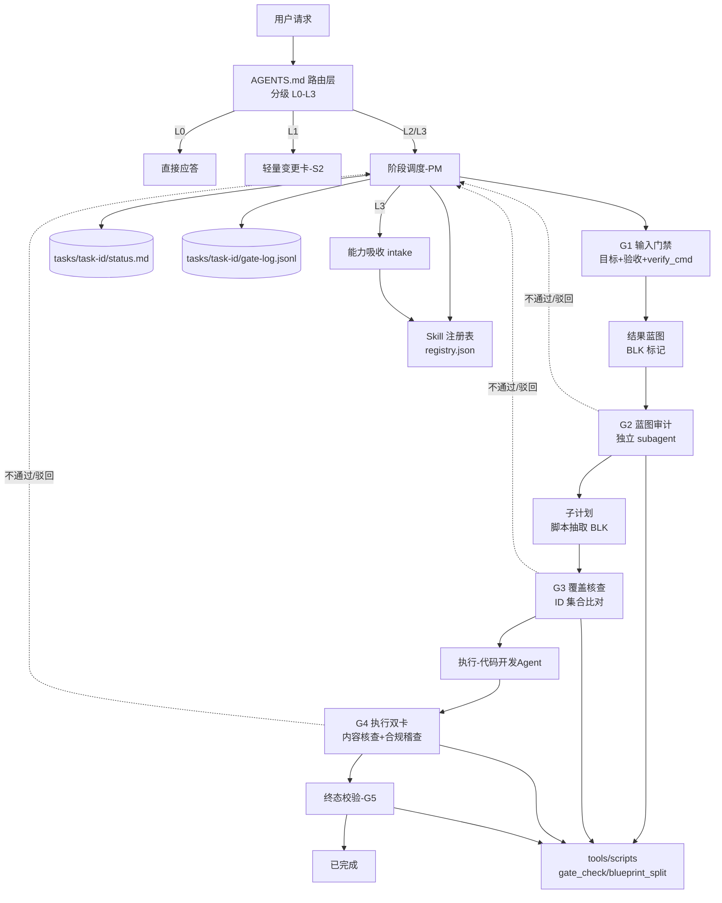

<!-- 创建时间: 2026-10-30 20:46 -->
<!-- 最后修改: 2026-10-30 20:46 -->

# 结果蓝图：AI Team 流程整改（Agent 治理终态）

> **维度映射说明**（本项目交付物是"治理体系"而非 Web 应用，四个维度按下表等价映射，后续子计划沿用同一映射）：
>
> | 模板维度 | 本项目对应物 |
> |---------|-------------|
> | 前端终态 | 用户交互面：对话场景、模板输出形态、确认点、看板 |
> | 后端终态 | Agent 调度接口：谁调谁、传什么、返回什么、失败如何回退 |
> | 数据层终态 | 文件与状态产物：status.md、gate-log.jsonl、报告 schema、registry |
> | 业务逻辑终态 | 流程规则、任务分级、关卡判定、状态流转、权限 |

---

## 现状诊断（问题台账）

| 编号 | 问题 | 证据 | 影响 | 级别 |
|------|------|------|------|------|
| P0-01 | 规则入口断链：全仓 16 处引用 `.cursorrules`，该文件不存在 | `grep .cursorrules` 命中 16 处 | 稽查/核查"依据条款"全部悬空，判定不可执行 | P0 |
| P0-02 | 模板位置断链：7 处要求去 `.opencode/instructions.md` 找模板，该目录不存在，真实模板在 `AGENTS.md` | `.ai-team/agents/pm/agent.md:14`、`agent-doc/workflow-status.md:6` | Agent 按指令找不到模板即自行发明输出 | P0 |
| P0-03 | 自检自证循环：蓝图审计/覆盖核查/逐行核查/稽查/测试全部由 PM 在同一上下文"扮演"，无独立性 | `.ai-team/agents/pm/agent.md:79`、`.ai-team/rules/workflow.md:96` | 自己写、自己判，"通过"无对抗性，质量不可信 | P0 |
| P0-04 | 通过标准无证据：所有关卡只填 ✅/❌，无 file:line、无命令退出码 | `AGENTS.md` 自检清单、`verification/agent.md:79-84` | 无法机器复核，✅ 可被凭空填写 | P0 |
| P0-05 | 状态机失真：`workflow-status.md` 记录的是"IBM i 到 Java 数据迁移"，与本仓实际工作无关；单文件单任务，多任务互相污染 | `agent-doc/workflow-status.md:14` | 所有 Agent 读错阶段，流程从第一步就偏 | P0 |
| P0-06 | 无 Skill 调用机制：Skill 仅以"关联路径表"罗列，无触发判定、无加载动作、无输出契约 | `.ai-team/agents/pm/agent.md:116-127` | "自动调用相关 skill" 无法实现，Skill 形同死配置 | P0 |
| P1-01 | 逐字拷贝蓝图→子计划：人工复制，蓝图改一次需改 N 个子计划，且"逐字一致"无法机器校验 | `.ai-team/rules/workflow.md:128` | 文档巨型重复 + 必然漂移 + 校验成本极高 | P1 |
| P1-02 | 规则三层重复：`AGENTS.md`（551 行）+ `rules/`（590 行）+ `agents/` 互相复制同一条规则 | 提示词增强规则出现在 3 处；结果先行 17 条与 PM 职责 21 条重叠 | 改一处漏两处，规则冲突无裁决 | P1 |
| P1-03 | 死规则：稽查 Agent 声称"执行前实时监察、监听执行步骤"，单 Agent 串行下不可实现 | `.ai-team/agents/audit/agent.md:30`、`161-173` | 规则不可执行 → 整体规则可信度下降 | P1 |
| P1-04 | 检查项编号重复：audit 中 1.17/1.18/1.19 各出现两次 | `.ai-team/agents/audit/agent.md:71-76` | "依据 1.17" 无唯一指向 | P1 |
| P1-05 | 无驳回上限：核查不通过 → PM 修正 → 重新核查，无轮次上限 | `.ai-team/rules/workflow.md:137` | 无限自循环，任务永不收敛 | P1 |
| P1-06 | 确认点开销固定：L0 咨询与 L3 能力变更走同一套 3 次确认 + 5 道关卡 | `AGENTS.md` 自动化闭环流程概览 | 小改动被流程淹没，反而促发"为了过流程而编造产出" | P1 |
| P1-07 | 测试无强制命令：子计划模板有"测试Agent验证"，但无 verify_cmd、无退出码要求 | `AGENTS.md` 子计划执行模板；`agents/testing/agent.md` 仅输出文档 | "已验证"不可证伪 | P1 |
| P1-08 | 无外部能力吸收流程：`custom-agent-foundry`/`skill-creator` 只定义"新建"，无导入/许可审查/重叠检测/回归 | `.ai-team/agents/skill-creator/agent.md:9-20` | 吸收外部 agent/skill 无准入门禁，必然引入重复与冲突 | P1 |
| P1-09 | 死链 Skill：`references.md` 列 `code-dev/ibmi/ibmi-documentation`，文件不存在 | `.ai-team/rules/references.md:52` | 引用即 404 | P1 |
| P2-01 | 清单与实际不符：README 称 18 Agent/30 Skill，实际 20 个 `agent.md`/34 个 `skill.md` | `.ai-team/README.md:21`、`:185`、`:209` | 清单不可作为盘点依据 | P2 |
| P2-02 | 仓库卫生：`tools/ibmi-analyzer - Copy/`、`tools/*.zip`、根目录 `plan/` 与 `agent-doc/plan/` 重复、无 `.gitignore` | `tools/`、`plan/2026-05-29/` | 检索噪声、误读旧版本、产出物混入版本库 | P2 |
| P2-03 | 元 Agent 无入口：`custom-agent-foundry`/`skill-creator` 未进入任何路由表 | `AGENTS.md` 默认角色表仅两项 | 配置存在但永不触发 | P2 |
| P2-04 | 无落点的规则：Session 计数提醒、用户请求记录无文件、无校验 | `.ai-team/agents/pm/agent.md:47-48` | 规则写了不做，持续稀释规则权威 | P2 |

---

## ① 需求分析Agent产出 — 前端终态（用户交互面）

### 场景完整列表

| 场景 | 用户角色 | 核心功能 | 入口路径 |
|------|---------|---------|---------|
| S1 分级应答 | 用户 | 识别 L0 咨询，直接回答，不产物、不确认 | 任意请求 → 分级器判定 L0 |
| S2 轻量变更卡 | 用户 | L1 小改动：一屏展示目标/改动文件/验收/验证命令，确认 1 次后执行 | 分级器判定 L1 |
| S3 蓝图确认 | 用户 | L2/L3 展示终态蓝图四维度 + 15 项自检 + 覆盖矩阵，确认 1 次 | 分级器判定 L2/L3 |
| S4 子计划确认 | 用户 | 展示 SP 清单（ID/名称/技术栈/依赖/verify_cmd），确认 1 次 | 蓝图通过 G2 后 |
| S5 执行看板 | 用户 | 从 status.md 渲染任务进度、当前关卡、阻塞项 | 任意时刻 `/status` |
| S6 关卡报告 | 用户 | G2–G5 每关输出结果摘要 + 证据列 + 阻塞列 | 关卡执行后 |
| S7 升级裁决 | 用户 | 同关卡累计 2 轮驳回后强制升级，列出两轮证据供用户裁决 | H5 触发 |
| S8 能力吸收报告 | 用户 | L3 intake：来源/许可/能力点/冲突/回归结果/结论 | 外部能力吸收请求 |
| S9 任务索引 | 用户 | 多任务列表（task_id/级别/阶段/最后更新） | `/tasks` |

### 非功能需求

| 类别 | 需求描述 | 验收标准 |
|------|---------|---------|
| 上下文预算 | `AGENTS.md` 常驻内容 ≤ 120 行；每次最多按需加载 1 个阶段模板 | 文件行数检查 + 单次回复引用模板 ≤ 1 |
| 可机读 | 所有关卡报告为固定字段 JSON，可被脚本判定 | `gate_check.py` 对报告 schema 校验通过率 100% |
| 可追溯 | 每次状态变更追加一行 `gate-log.jsonl`，禁止覆盖 | 日志行数 = 状态变更次数；含 ts/actor/gate |
| 幂等 | 同一关卡重复执行，结论稳定（同输入同输出） | 连续两次执行结论一致 |
| 不发散 | 无级别不得产出蓝图/计划；无 SKILL 声明不得声称使用该 Skill | 抽查 10 次回复，越级产出 0 次 |
| 可移植 | 入口唯一为 `AGENTS.md`，可在 opencode/Copilot/Claude 复用 | 全仓无 `.cursorrules`、`.opencode` 引用 |

### 角色与权限

| 角色 | 可访问场景 | 可执行操作 |
|------|-----------|-----------|
| 用户 | S1–S9 | 全部确认、裁决、驳回 |
| PM Agent | S1–S9 | 分级、调度、写 `status.md`、写 `gate-log.jsonl`、触发关卡 |
| 核查 Agent | S6 | 只读产物与判定标准；只写 `reports/*-verification*.json` |
| 稽查 Agent | S6 | 只读产物与规则；只写 `reports/*-audit*.json` |
| 测试 Agent | S6 | 只读子计划与代码；执行 `verify_cmd`；只写 `reports/*-test*.json` |
| 代码开发 Agent | 无（后台） | 只写 `agent-doc/code/` |
| 知识管理 Agent | 无（后台） | 只写 `knowledge-base/`，且需用户确认 |
| Skill/Agent Creator | S8 | 只写 `.ai-team/skills/`、`.ai-team/agents/`、`intake/` |

---

## ② 架构设计Agent产出 — 系统架构终态

### 架构图

**Mermaid源码**（使用 `flowchart` 语法）：


### 模块划分

| 模块 | 职责 | 技术选型 | 选型理由 |
|------|------|---------|---------|
| M1 路由层 | 分级、硬规则、阶段→模板索引 | `AGENTS.md` ≤120 行 | opencode 自动加载，唯一常驻上下文 |
| M2 规则层 | 流程/关卡/技能/吸收规则本体 | `.ai-team/rules/*.md`，规则 ID `R-<域>-<序号>` | 单一真相源，可被引用定位 |
| M3 角色层 | 角色契约（何时调谁/输入输出），不写规则 | `.ai-team/agents/*/agent.md` | 职责与规则解耦 |
| M4 方法层 | Skill 方法与注册 | `.ai-team/skills/**` + `registry.json` | 触发可判定、加载可声明 |
| M5 关卡层 | G1–G5 定义与报告 schema | `.ai-team/rules/gate-rules.md` + `.ai-team/templates/stages/` | 关卡与模板分离，按需加载 |
| M6 产物层 | 状态、日志、报告、计划、代码 | `agent-doc/tasks/{task-id}/` | 多任务隔离 |
| M7 工具层 | 机读判定与生成 | `tools/scripts/*.py`（Python 3.11+ 标准库） | 消除人工逐字拷贝与断链 |
| M8 知识层 | 经验/决策/模式 | `.ai-team/knowledge-base/` | 按需引用，不进常驻上下文 |

### 部署方案

| 环境 | 服务器 | 中间件 | 高可用方案 |
|------|--------|--------|-----------|
| 开发 | 本地单仓（Git） | opencode CLI | 无（文件型，无需 HA） |
| 生产（其他项目复用） | 目标项目根目录 | opencode / Copilot / Claude Code | 只复制 `AGENTS.md` + `.ai-team/`，入口唯一化 |
| 校验 | 本地单仓 | Python 3.11+ | 关卡脚本幂等，可重复执行 |

### 模块间交互关系

| 调用方 | 被调用方 | 通信方式 | 接口协议 |
|--------|---------|---------|---------|
| M1 路由层 | M2 规则层 | 文件引用 | 规则 ID `R-<域>-<序号>` |
| M1 路由层 | M5 关卡层 | 文件引用 | 阶段→模板文件名映射 |
| M3 PM | M4 方法层 | 注册表查询 | `registry.json` 按 trigger 匹配 |
| M3 PM | M3 核查/稽查/测试 | subagent 调用 | 输入：产物路径+判定标准+schema；输出：固定字段 JSON |
| M5 关卡层 | M7 工具层 | 命令行 | `python tools/scripts/gate_check.py --task <id> --gate <Gx>` |
| M5 关卡层 | M6 产物层 | 文件写入 | `reports/{gate}-report.json` |
| M3 PM | M6 产物层 | 文件写入 | `status.md` + `gate-log.jsonl`（append-only） |

---

## ③ 功能设计Agent产出 — 功能与交互终态

### S1 分级应答（L0）

```
+----------------------------------------------------------+
| [Agent] L0 咨询 · 不产物 · 不确认                          |
+----------------------------------------------------------+
|  直接回答（≤4 行）                                          |
|  如需执行改动 → 声明升级为 L1 并给出 1 行计划                |
+----------------------------------------------------------+
| 证据行：[无文件变更]                                        |
+----------------------------------------------------------+
```

### S2 轻量变更卡（L1）

```
+----------------------------------------------------------+
| L1 轻量变更  T2026-1030-01                  [确认/驳回]    |
+----------------------------------------------------------+
| 目标：_____________________________________________       |
| 改动：                                                      |
|   1. path:line  → 变更摘要                                  |
|   2. path:line  → 变更摘要                                  |
| 不做：_____________________________________________       |
+----------------------------------------------------------+
| 验收（可机读）：                                            |
|   1. cmd + 期望退出码                                       |
|   2. file:line 存在性断言                                   |
+----------------------------------------------------------+
| 证据承诺：执行后逐条回填实际输出                             |
+----------------------------------------------------------+
```

### S3 蓝图确认（L2/L3）

```
+----------------------------------------------------------+
| L2 结果蓝图确认  T2026-1030-01                [确认/驳回]   |
+----------------------------------------------------------+
| ① 用户交互终态  场景 9 项 · 非功能 6 项 · 权限 8 角色       |
| ② 架构终态      模块 8 · 交互 7 · 部署 3 环境               |
| ③ 功能终态      线框 9 · 交互元素 n · 字段 n                |
| ④ 技术终态      接口 12 · 产物 schema 8 · 脚本 5 · 规则 10  |
+----------------------------------------------------------+
| 交叉校验 4/4 通过 · 自检 15/15 ✅ · 覆盖矩阵已产出          |
| BLK 索引：FR 9 / AR 8 / FN n / API 12 / TBL 8 / BIZ n       |
+----------------------------------------------------------+
| [待用户确认: xxx] 剩余 0 项                                 |
+----------------------------------------------------------+
```

### S4 子计划确认（L2/L3）

```
+----------------------------------------------------------+
| 子计划清单  T2026-1030-01                     [确认/驳回]   |
+----------------------------------------------------------+
| SP-01 | 名称 | 技术栈 | 依赖 | verify_cmd | BLK 覆盖数      |
| SP-02 | 名称 | 技术栈 | 依赖 | verify_cmd | BLK 覆盖数      |
+----------------------------------------------------------+
| 合计：SP n 项 · BLK 覆盖 100% · 无跳转词 · 无省略表述       |
+----------------------------------------------------------+
```

### S5 执行看板

```
+----------------------------------------------------------+
| 任务 T2026-1030-01   L2   阶段：执行中                      |
+----------------------------------------------------------+
| G1 输入门禁  通过   r1   2026-10-30 20:50                   |
| G2 蓝图审计  通过   r1   2026-10-30 21:02                   |
| G3 覆盖核查  通过   r1   2026-10-30 21:20                   |
| G4 执行双卡  进行中 r1   内容 3/7 · 合规 待执行              |
| G5 终态校验  待执行 -                                       |
+----------------------------------------------------------+
| 阻塞：SP-04 依赖 tools/scripts/gate_check.py 未产出          |
+----------------------------------------------------------+
```

### S6 关卡报告

```
+----------------------------------------------------------+
| G3 覆盖核查报告  T2026-1030-01  r1          [JSON 已落盘]   |
+----------------------------------------------------------+
| 判定：通过 / 不通过                                          |
| BLK 总数 42 · 已覆盖 42 · 遗漏 0 · 跳转词 0 · 省略词 0      |
+----------------------------------------------------------+
| 证据：                                                      |
|   E1 tools/scripts/gate_check.py 退出码 0                   |
|   E2 reports/coverage-report.json sha256 ab12…              |
|   E3 tasks/…/plan/SP-03-xxx.md:14 BLK:API-007               |
+----------------------------------------------------------+
| 阻塞项：无                                                   |
+----------------------------------------------------------+
```

### S7 升级裁决

```
+----------------------------------------------------------+
| 升级裁决  T2026-1030-01  G4  已达驳回上限 2 轮   [裁决]     |
+----------------------------------------------------------+
| 轮次1：不通过 原因：证据缺失 E2                              |
| 轮次2：不通过 原因：同一项仍缺失 E2（未修复）                 |
+----------------------------------------------------------+
| 待裁决选项：                                                |
|   1 接受现状并记录豁免（写入 gate-log，需用户签名行）        |
|   2 终止该子计划并回退                                       |
|   3 放宽验收标准（改写子计划 verify_cmd）                    |
+----------------------------------------------------------+
```

### S8 能力吸收报告

```
+----------------------------------------------------------+
| 能力吸收 intake  {date}-{name}                 [确认/驳回]  |
+----------------------------------------------------------+
| 来源：URL/仓库          许可证：MIT/Apache/未知              |
| 能力点：1 … 2 …                                             |
| 映射：agent=…  skill=…                                      |
| 重叠：与 {skill} 重合 65% → 建议合并而非新增                 |
| 回归：cases n · 通过 n · 失败 0                              |
+----------------------------------------------------------+
| 结论：采纳 / 改写采纳 / 拒绝   （未知许可 → 强制拒绝）        |
+----------------------------------------------------------+
```

### S9 任务索引

```
+----------------------------------------------------------+
| 任务索引（按最后更新倒序）                                   |
+----------------------------------------------------------+
| T2026-1030-01 | L2 | 执行中   | 2026-10-30 21:40            |
| T2026-1031-01 | L1 | 已完成   | 2026-10-31 09:12            |
+----------------------------------------------------------+
```

### 交互元素完整列表

| 元素 | 类型 | 位置 | 操作 | 反馈 |
|------|------|------|------|------|
| 级别判定 | 自动 | S1 进入 | 判定 L0–L3 | 写入 `status.md` 的 `level` |
| 确认按钮 | 对话指令 | S2/S3/S4/S8 | 用户回复"确认" | 关卡置为通过，写入 gate-log |
| 驳回按钮 | 对话指令 | S2/S3/S4/S8 | 用户提修改意见 | 关卡不通过，round+1 |
| 升级裁决 | 对话指令 | S7 | 用户选择 1/2/3 | 写入 gate-log，决定后续 |
| 看板查询 | 命令 | S5 | `/status` | 渲染 status.md |
| 任务列表 | 命令 | S9 | `/tasks` | 列出 `agent-doc/tasks/*` |
| 证据行 | 自动 | S2/S6 | 关卡执行 | 追加 file:line 或 cmd+退出码 |
| SKILL 声明 | 自动 | 任意 | 加载 Skill | 回复首行输出 `SKILL: name@ver` |

### 表单/字段完整定义

**status.md**

| 字段 | 类型 | 必填 | 校验规则 | 默认值 |
|------|------|------|---------|--------|
| task_id | 字符串 | 是 | `T{yyyy-MMdd}-{seq}` | 生成时写入 |
| title | 字符串 | 是 | ≤40 字 | 无 |
| level | 枚举 | 是 | L0/L1/L2/L3 | 无 |
| stage | 枚举 | 是 | 分级/蓝图/子计划/执行/终态校验/已完成/阻塞 | 分级 |
| gate.G1..G5.status | 枚举 | 是 | 待执行/进行中/通过/不通过/已升级/豁免 | 待执行 |
| gate.Gx.round | 整数 | 是 | 1..2，>2 必须已升级 | 0 |
| gate.Gx.report | 路径 | Gx≥2 时必填 | 文件存在 | 无 |
| acceptance | 列表 | 是 | 每项含 cmd 或 file:line 断言 | 无 |
| verify_cmds | 列表 | L2/L3 必填 | 可在本地执行且幂等 | 无 |
| updated_at | 时间 | 是 | `yyyy-MM-dd HH:mm` | 无 |

**gate-report.json**

| 字段 | 类型 | 必填 | 校验规则 | 默认值 |
|------|------|------|---------|--------|
| gate | 字符串 | 是 | G1–G5 | 无 |
| task_id | 字符串 | 是 | 与目录一致 | 无 |
| round | 整数 | 是 | ≥1 | 1 |
| verdict | 枚举 | 是 | pass/fail/escalated | 无 |
| checked | 整数 | 是 | ≥0 | 0 |
| failed | 整数 | 是 | ≥0 且 ≤checked | 0 |
| evidence | 列表 | 是 | 每项含 type(file/cmd)+ref+result | 无 |
| blocking | 列表 | fail 时必填 | 每项含 R-ID 或 BLK-ID | 无 |
| ts | 时间 | 是 | ISO 8601 | 无 |

**registry.json 条目**

| 字段 | 类型 | 必填 | 校验规则 | 默认值 |
|------|------|------|---------|--------|
| name | 字符串 | 是 | 全局唯一、等于目录名 | 无 |
| version | 字符串 | 是 | 语义化 `x.y.z` | 1.0.0 |
| path | 路径 | 是 | 文件存在 | 无 |
| trigger.keywords | 列表 | 是 | ≥1，全局无交叉重复 | 无 |
| trigger.agents | 列表 | 是 | 属于 20 个 agent 之一 | 无 |
| inputs | 列表 | 是 | ≥1 | 无 |
| outputs | 列表 | 是 | ≥1，含落盘路径模式 | 无 |
| verify | 字符串 | 是 | 可执行命令或"人工检查清单路径" | 无 |
| source | 字符串 | 是 | internal / 外部 URL / 仓库 | internal |

**intake 记录**

| 字段 | 类型 | 必填 | 校验规则 | 默认值 |
|------|------|------|---------|--------|
| source | 字符串 | 是 | URL 或仓库地址 | 无 |
| license | 字符串 | 是 | MIT/Apache-2.0/BSD/未知 | 无 |
| capability_points | 列表 | 是 | ≥1 | 无 |
| mapping | 对象 | 是 | agent + skill | 无 |
| overlap | 对象 | 是 | 与现有 skill 的重合度 0–100% | 无 |
| diff | 列表 | 是 | 相对原版的改写点 | 无 |
| regression | 对象 | 是 | cases_path + passed + failed | 无 |
| verdict | 枚举 | 是 | adopt/rewrite/reject | 无 |
| approved_by | 字符串 | 是 | user | 无 |

### 场景间导航关系

```
S1 → S2（请求含改动意图）
S2 → S5（确认后执行）
S3 → S4（G2 通过后）
S4 → S5（确认后）
S5 → S6（关卡执行）
S6 → S7（同关驳回累计 2 轮）
S6 → S5（继续下一子计划）
S3/S4/S5 → S8（L3 能力变更分支）
任意 → S9（/tasks）
S5 → S1（用户转为咨询，级别降为 L0）
```

---

## ④ 技术设计Agent产出 — 技术实现终态

### Agent 接口完整定义

| 编号 | 调用方→被调方 | 方法 | 功能 | 请求参数 | 响应格式 | 失败码 |
|------|--------------|------|------|---------|---------|--------|
| API-001 | 路由层→PM | `classify` | 任务分级 | request 文本 | `{level, goal, acceptance[], verify_cmds[]}` | E-CLS-01 无法定级 |
| API-002 | PM→核查 | `auditBlueprint` | 蓝图完整性审计 | blueprint 路径、checklist 路径 | gate-report.json | E-AUD-01 缺章节 |
| API-003 | PM→核查 | `checkCoverage` | 蓝图→子计划覆盖 | blueprint 路径、spDir | gate-report.json | E-COV-01 BLK 遗漏 |
| API-004 | PM→核查 | `checkSteps` | 子计划→产出逐行 | sp 路径、产物路径列表 | gate-report.json | E-STEP-01 步骤未实现 |
| API-005 | PM→稽查 | `inspect` | 合规稽查 | taskDir、ruleIds[] | gate-report.json | E-CMP-01 规则违背 |
| API-006 | PM→测试 | `verify` | 执行验证 | sp 路径、verify_cmds[] | `{passed, failed, evidence[]}` | E-TST-01 命令非零退出 |
| API-007 | PM→代码开发 | `execute` | 代码实现 | sp 路径 | `{artifacts[]}` | E-DEV-01 产物缺失 |
| API-008 | 任意 Agent→Skill 层 | `load` | 加载 Skill | name | `{body, declaration}` | E-SKL-01 未注册 |
| API-009 | PM→Creator | `absorb` | 外部能力吸收 | source | intake 记录 + registry 补丁 | E-INT-01 许可未知 |
| API-010 | PM→产物层 | `updateStatus` | 状态更新 | taskId、patch | status.md + gate-log 一行 | E-STS-01 非法状态流转 |
| API-011 | PM→核查 | `finalCheck` | 终态校验 | blueprint 路径、taskDir | gate-report.json | E-FIN-01 BLK 未覆盖 |
| API-012 | 关卡层→工具层 | `gate_check` | 机读判定 | taskId、gate | 退出码 + JSON stdout | 退出码 2 = 证据不足 |

### 每个接口的参数详情

**API-001 `classify`**
请求参数：
| 参数名 | 位置 | 类型 | 必填 | 说明 |
|--------|------|------|------|------|
| request | body | string | 是 | 用户原始请求 |
| status_hint | body | string | 否 | 当前 status.md 路径（续做场景） |

响应体：
```json
{ "level": "L0|L1|L2|L3", "goal": "string", "acceptance": ["cmd 或 file:line 断言"], "verify_cmds": ["string"] }
```

**API-002 `auditBlueprint`**
请求参数：
| 参数名 | 位置 | 类型 | 必填 | 说明 |
|--------|------|------|------|------|
| blueprint | path | string | 是 | 蓝图文件路径 |
| checklist | path | string | 是 | `rules/gate-rules.md` 中 G2 清单锚点 |

响应体：
```json
{ "gate": "G2", "verdict": "pass|fail", "checked": 15, "failed": 0, "evidence": [], "blocking": [] }
```

**API-003 `checkCoverage`**
请求参数：
| 参数名 | 位置 | 类型 | 必填 | 说明 |
|--------|------|------|------|------|
| blueprint | path | string | 是 | 蓝图路径（含 BLK 标记） |
| sp_dir | path | string | 是 | 子计划目录 |
| require_machine | bool | query | 否 | 为真时必须由 `gate_check.py` 复核，默认 true |

响应体：
```json
{ "gate": "G3", "verdict": "pass", "checked": 42, "failed": 0, "evidence": [{"type":"cmd","ref":"gate_check.py","result":"exit=0"}] }
```

**API-004 `checkSteps`**
请求参数：
| 参数名 | 位置 | 类型 | 必填 | 说明 |
|--------|------|------|------|------|
| sp | path | string | 是 | 子计划文件 |
| artifacts | list | string | 是 | 实际产出路径 |

响应体：
```json
{ "gate": "G4", "sub_gate": "content", "verdict": "pass", "checked": 7, "failed": 0, "evidence": [], "blocking": [] }
```

**API-005 `inspect`**
请求参数：
| 参数名 | 位置 | 类型 | 必填 | 说明 |
|--------|------|------|------|------|
| task_dir | path | string | 是 | 任务目录 |
| rule_ids | list | string | 是 | 适用规则 ID，如 R-WF-03 |

响应体：
```json
{ "gate": "G4", "sub_gate": "compliance", "verdict": "pass", "checked": 10, "failed": 0, "evidence": [], "blocking": [] }
```

**API-006 `verify`**
请求参数：
| 参数名 | 位置 | 类型 | 必填 | 说明 |
|--------|------|------|------|------|
| sp | path | string | 是 | 子计划文件 |
| verify_cmds | list | string | 是 | 子计划中定义的可执行命令 |

响应体：
```json
{ "passed": 3, "failed": 0, "evidence": [{"type":"cmd","ref":"pytest -q","result":"exit=0"}] }
```

**API-007 `execute`**
请求参数：
| 参数名 | 位置 | 类型 | 必填 | 说明 |
|--------|------|------|------|------|
| sp | path | string | 是 | 子计划文件 |
| tech_stack | enum | string | 是 | java/frontend/ibmi/devops |

响应体：
```json
{ "artifacts": ["agent-doc/code/.../A.java"], "notes": "string" }
```

**API-008 `load`**
请求参数：
| 参数名 | 位置 | 类型 | 必填 | 说明 |
|--------|------|------|------|------|
| name | query | string | 是 | 注册表中存在的 Skill 名 |

响应体：
```json
{ "body": "markdown 全文", "declaration": "SKILL: name@1.0.0" }
```

**API-009 `absorb`**
请求参数：
| 参数名 | 位置 | 类型 | 必填 | 说明 |
|--------|------|------|------|------|
| source | body | string | 是 | URL 或仓库路径 |
| target_agent | body | string | 否 | 期望归属 Agent |

响应体：
```json
{ "intake_path": "agent-doc/tasks/{id}/intake/{date}-{name}.md", "verdict": "adopt|rewrite|reject", "registry_patch": {} }
```

**API-010 `updateStatus`**
请求参数：
| 参数名 | 位置 | 类型 | 必填 | 说明 |
|--------|------|------|------|------|
| task_id | path | string | 是 | 任务 ID |
| patch | body | object | 是 | 仅允许合法状态迁移 |

响应体：
```json
{ "status_path": "agent-doc/tasks/{id}/status.md", "log_appended": true }
```

**API-011 `finalCheck`**
请求参数：
| 参数名 | 位置 | 类型 | 必填 | 说明 |
|--------|------|------|------|------|
| blueprint | path | string | 是 | 蓝图文件 |
| task_dir | path | string | 是 | 任务目录 |

响应体：
```json
{ "gate": "G5", "verdict": "pass", "checked": 42, "failed": 0, "evidence": [], "blocking": [] }
```

**API-012 `gate_check`**
请求参数：
| 参数名 | 位置 | 类型 | 必填 | 说明 |
|--------|------|------|------|------|
| task | path | string | 是 | `--task <task_id>` |
| gate | enum | string | 是 | `--gate G1..G5` |

响应体：
```json
{ "ok": true, "gate": "G3", "exit": 0, "detail": "BLK 42/42, jumpwords 0" }
```

### 文件与状态产物完整设计（数据层终态）

**产物 D1：`agent-doc/tasks/{task-id}/status.md`**

| 字段 | 类型 | 长度 | 主键 | 外键 | 索引 | 默认值 | 说明 |
|------|------|------|------|------|------|--------|------|
| task_id | string | 24 | PK | — | Y | 无 | `T{yyyy-MMdd}-{seq}` |
| title | string | 40 | — | — | N | 无 | 任务名 |
| level | enum | 2 | — | — | Y | 无 | L0–L3 |
| stage | enum | 12 | — | — | Y | 分级 | 见状态流转表 |
| gate_G1_status | enum | 8 | — | — | N | 待执行 | 待执行/进行中/通过/不通过/已升级/豁免 |
| gate_G1_round | int | — | — | — | N | 0 | ≤2 |
| gate_G1_report | path | 255 | — | D5 | N | 无 | 报告路径 |
| gate_G2_status | enum | 8 | — | — | N | 待执行 | 同上 |
| gate_G2_round | int | — | — | — | N | 0 | 同上 |
| gate_G2_report | path | 255 | — | D5 | N | 无 | 同上 |
| gate_G3_status | enum | 8 | — | — | N | 待执行 | 同上 |
| gate_G3_round | int | — | — | — | N | 0 | 同上 |
| gate_G3_report | path | 255 | — | D5 | N | 无 | 同上 |
| gate_G4_status | enum | 8 | — | — | N | 待执行 | 同上 |
| gate_G4_round | int | — | — | — | N | 0 | 同上 |
| gate_G4_report | path | 255 | — | D5 | N | 无 | 同上 |
| gate_G5_status | enum | 8 | — | — | N | 待执行 | 同上 |
| gate_G5_round | int | — | — | — | N | 0 | 同上 |
| gate_G5_report | path | 255 | — | D5 | N | 无 | 同上 |
| acceptance | list | — | — | — | N | 无 | 可机读验收项 |
| verify_cmds | list | — | — | — | N | 无 | L2/L3 必填 |
| updated_at | datetime | 16 | — | — | Y | 无 | `yyyy-MM-dd HH:mm` |

**产物 D2：`agent-doc/tasks/{task-id}/gate-log.jsonl`**

| 字段 | 类型 | 长度 | 主键 | 外键 | 索引 | 默认值 | 说明 |
|------|------|------|------|------|------|--------|------|
| ts | datetime | 19 | — | — | Y | 无 | ISO 8601 |
| task_id | string | 24 | — | D1 | Y | 无 | 任务 ID |
| gate | enum | 2 | — | — | Y | 无 | G1–G5 |
| action | enum | 10 | — | — | N | 无 | start/verdict/rectify/escalate/waive |
| actor | enum | 20 | — | — | N | 无 | 角色名 |
| round | int | — | — | — | N | 1 | 轮次 |
| result | enum | 9 | — | — | N | 无 | pass/fail/escalated |
| evidence_digest | string | 64 | — | — | N | 无 | 证据列表 sha256 |
| blocking_digest | string | 64 | — | — | N | 无 | 阻塞列表 sha256 |

**产物 D3：`agent-doc/result-first/{date}-{seq}-{name}-result-blueprint.md`（BLK 规范）**

| 字段 | 类型 | 长度 | 主键 | 外键 | 索引 | 默认值 | 说明 |
|------|------|------|------|------|------|--------|------|
| blk_marker | HTML 注释 | — | PK | — | Y | 无 | `<!-- BLK:FR-001 -->` |
| blk_ns | 前缀 | 3 | — | — | Y | 无 | FR/AR/FN/API/TBL/BIZ/NFR |
| blk_seq | 数字 | 3 | — | — | Y | 无 | 同命名空间内递增 |
| blk_owner | 角色 | 20 | — | — | N | 无 | 产出该块的角色 |
| blk_verify | 断言 | — | — | — | N | 无 | cmd 或 file:line |

**产物 D4：`agent-doc/tasks/{task-id}/plan/SP-XX-{name}.md`**

| 字段 | 类型 | 长度 | 主键 | 外键 | 索引 | 默认值 | 说明 |
|------|------|------|------|------|------|--------|------|
| sp_id | string | 5 | PK | — | Y | 无 | SP-01… |
| tech_stack | enum | 10 | — | — | Y | 无 | java/frontend/ibmi/devops/doc |
| depends_on | list | — | — | D4 | N | 无 | 前置 SP |
| blk_refs | list | — | — | D3 | Y | 无 | 覆盖的 BLK ID |
| final_result | markdown | — | — | — | N | 无 | 由脚本从 D3 抽取生成 |
| steps | list | — | — | — | N | 无 | 每步 做什么/怎么做/正反约束 |
| verify_cmd | string | 255 | — | — | N | 无 | 必填，可执行 |
| acceptance | list | — | — | — | N | 无 | 可机读 |

**产物 D5：`agent-doc/tasks/{task-id}/reports/{gate}-{kind}-report.json`**

| 字段 | 类型 | 长度 | 主键 | 外键 | 索引 | 默认值 | 说明 |
|------|------|------|------|------|------|--------|------|
| gate | enum | 2 | PK | — | Y | 无 | G2–G5 |
| kind | enum | 12 | PK | — | Y | 无 | blueprint/coverage/content/compliance/test/final |
| task_id | string | 24 | — | D1 | Y | 无 | 任务 ID |
| round | int | — | — | — | N | 1 | 轮次 |
| verdict | enum | 9 | — | — | Y | 无 | pass/fail/escalated |
| checked | int | — | — | — | N | 0 | 检查项数 |
| failed | int | — | — | — | N | 0 | 失败数 |
| evidence | list | — | — | — | N | 无 | type/ref/result |
| blocking | list | — | — | — | N | 无 | R-ID 或 BLK-ID |
| ts | datetime | 19 | — | — | Y | 无 | ISO 8601 |

**产物 D6：`.ai-team/skills/registry.json`**

| 字段 | 类型 | 长度 | 主键 | 外键 | 索引 | 默认值 | 说明 |
|------|------|------|------|------|------|--------|------|
| name | string | 60 | PK | — | Y | 无 | 唯一，等于目录名 |
| version | string | 10 | — | — | N | 1.0.0 | 语义化 |
| path | path | 255 | — | — | Y | 无 | skill.md 路径 |
| trigger_keywords | list | — | — | — | Y | 无 | 全局唯一 |
| trigger_agents | list | — | — | — | N | 无 | 归属 Agent |
| inputs | list | — | — | — | N | 无 | 输入项 |
| outputs | list | — | — | — | N | 无 | 落盘路径模式 |
| verify | string | 255 | — | — | N | 无 | 校验命令 |
| source | string | 255 | — | — | N | internal | 来源与许可 |
| owner | string | 40 | — | — | N | 无 | 维护角色 |

**产物 D7：`agent-doc/tasks/{task-id}/intake/{date}-{name}.md`**

| 字段 | 类型 | 长度 | 主键 | 外键 | 索引 | 默认值 | 说明 |
|------|------|------|------|------|------|--------|------|
| source | string | 255 | PK | — | N | 无 | URL/仓库 |
| license | string | 20 | — | — | Y | 无 | 未知 → 强制拒绝 |
| capability_points | list | — | — | — | N | 无 | 能力点 |
| mapping_agent | string | 40 | — | D6 | N | 无 | 归属 Agent |
| mapping_skill | string | 60 | — | D6 | N | 无 | 对应 Skill |
| overlap_ratio | int | 3 | — | — | N | 0 | 0–100 |
| diff | list | — | — | — | N | 无 | 改写点 |
| regression_cases | path | 255 | — | — | N | 无 | 回归用例路径 |
| regression_result | enum | 9 | — | — | N | 无 | pass/fail |
| verdict | enum | 7 | — | — | Y | 无 | adopt/rewrite/reject |
| approved_by | string | 20 | — | — | N | 无 | user |

**产物 D8：`.ai-team/skills/regression/{skill}/cases.md`**

| 字段 | 类型 | 长度 | 主键 | 外键 | 索引 | 默认值 | 说明 |
|------|------|------|------|------|------|--------|------|
| case_id | string | 12 | PK | — | Y | 无 | RC-001 |
| inputs | 文本 | — | — | — | N | 无 | 固定输入 |
| expected | 文本 | — | — | — | N | 无 | 可判定期望 |
| assert_cmd | string | 255 | — | — | N | 无 | 断言命令 |

### 后端处理链路

**链路：用户请求 → 交付**

```
[用户请求] → [M1 分级 API-001] → [写入 D1 stage=分级]
  ↓              ↓                      ↓
[意图文本]   [L0/L1/L2/L3]        [D2 追加 start 行]
  ↓
L0 → 直接应答（不产物）
L1 → S2 卡 → 用户确认 → 执行 → 自查证据 → D1=已完成
L2/L3 → G1 输入门禁 → D3 蓝图（BLK）→ G2 API-002 → 用户确认
      → D4 子计划（脚本抽取 BLK）→ G3 API-003 + API-012 → 用户确认
      → 逐 SP：API-007 执行 → API-006 验证 → API-004 内容核查 + API-005 合规稽查
      → G5 API-011 → D1=已完成
  ↓
[D5 报告落盘] → [D2 追加 verdict 行] → [Git 提交]
```

### 业务逻辑终态（规则/状态流转/权限）

**硬规则 H1–H10（规则 ID 前缀 `R-HR`）**

| ID | 规则 | 约束 |
|----|------|------|
| R-HR-01 | 单一真相源 | `AGENTS.md` ≤120 行，只含门禁+分级+路由；规则本体在 `rules/`，方法在 `skills/`；跨层只允许引用 ID，禁止复制原文 |
| R-HR-02 | 分级先行 | 每个请求第一步产出 `level`，写入 D1；无级别不得进入任何阶段 |
| R-HR-03 | 无证据不通过 | 任何"通过/完成"必须附 `file:line` 或 `cmd+退出码`；缺证据按 `fail` 处理 |
| R-HR-04 | 自检独立 | 核查/稽查/测试以 subagent 运行，输入只含"产物路径+判定标准+输出 schema"，不得携带 PM 结论 |
| R-HR-05 | 驳回上限 | 同一关卡同一任务最多 2 轮驳回；第 3 轮强制升级 S7，由用户裁决 |
| R-HR-06 | 状态唯一 | 状态唯一来源为 D1；禁止依据对话历史推断；多任务以 task_id 隔离 |
| R-HR-07 | Skill 显式加载 | 命中 D6 trigger 才可加载；回复首行必须声明 `SKILL: name@ver` |
| R-HR-08 | 拷贝自动化 | 子计划 `final_result` 由 `blueprint_split.py` 从 D3 抽取生成；禁止人工复制 |
| R-HR-09 | 不发散 | L0/L1 不得产出蓝图与子计划；单次回复只加载 1 个阶段模板；禁止全量输出 551 行模板 |
| R-HR-10 | 能力变更准入 | 新增/修改 agent/skill/规则必须走 intake 或元审计，附回归用例结果；许可未知一律拒绝 |

**分级判定表（`R-LV`）**

| 级别 | 判定条件 | 确认次数 | 关卡 | 产出物 |
|------|---------|---------|------|--------|
| L0 | 纯问答、无文件变更 | 0 | 无 | 无 |
| L1 | 单文件或 ≤50 行改动、无接口/数据变更 | 1（S2） | G4 轻量（自查+证据） | 变更摘要 |
| L2 | 跨文件/跨模块、含接口或数据变更 | 2（S3+S4） | G1–G5 | D3/D4/D5 |
| L3 | 改 agent/skill/规则本身、或吸收外部能力 | 3（S3+S4+S8） | G1–G5 + 元审计 | 追加 D7/D8 |

**状态流转（`R-ST`）**

| 当前 | 允许迁移 | 禁止 |
|------|---------|------|
| 分级 | 蓝图（L2/L3）/ 已完成（L0/L1）/ 阻塞 | 直接进入执行 |
| 蓝图 | 子计划（G2 pass）/ 蓝图（G2 fail，round<2）/ 已升级（round=2） | 跳过 G2 |
| 子计划 | 执行（G3 pass）/ 子计划（G3 fail） | 无 G3 直接执行 |
| 执行 | 执行（下一 SP）/ 终态校验（全部 SP pass）/ 已升级 | 未过 G4 进入下一 SP |
| 终态校验 | 已完成（G5 pass）/ 执行（G5 fail） | 直接标记完成 |
| 已完成 | —（终态） | 回退（如需回退新建任务） |
| 阻塞 | 原阶段（解除后） | 直接完成 |

**权限（`R-PM`）**

| 角色 | 写 D1 | 写 D2 | 写 D5 | 写代码 | 写 skills | 写 rules |
|------|-------|-------|-------|--------|-----------|----------|
| PM | Y | Y | N | N | N | N |
| 核查 | N | N | Y（verification） | N | N | N |
| 稽查 | N | N | Y（audit） | N | N | N |
| 测试 | N | N | Y（test） | Y（测试代码） | N | N |
| 代码开发 | N | N | N | Y | N | N |
| Creator | N | N | N | N | Y | N（需用户确认） |
| 用户 | 全部 | 全部 | 全部 | 全部 | 全部 | 全部 |

### 工具脚本定义（交付物）

| 编号 | 脚本 | 功能 | 退出码语义 |
|------|------|------|-----------|
| T1 | `tools/scripts/gate_check.py` | 校验 D5 schema、证据完整性、BLK 覆盖率、跳转词/省略词 | 0 通过 / 1 不通过 / 2 证据不足 |
| T2 | `tools/scripts/blueprint_split.py` | 按 BLK 从 D3 抽取生成 D4 `final_result` | 0 成功 / 1 BLK 缺失 |
| T3 | `tools/scripts/metadata_check.py` | 校验文档首两行创建/修改时间 | 0 合规 / 1 缺失 |
| T4 | `tools/scripts/registry_lint.py` | 校验 D6 与 skill 文件一致、trigger 唯一、path 存在 | 0 通过 / 1 不一致 |
| T5 | `tools/scripts/link_check.py` | 校验全仓文档内引用的路径真实存在 | 0 通过 / 1 死链 |

### 交付文件清单（17 项）

| 编号 | 文件 | 动作 | 验收断言 |
|------|------|------|---------|
| F01 | `AGENTS.md` | 重构 ≤120 行（门禁+分级+路由+模板索引） | `wc -l` ≤120；含 R-HR-01..10 |
| F02 | `.ai-team/rules/workflow.md` | 重写为流程本体（分级/关卡/证据/上限） | 规则 ID 全覆盖 R-HR |
| F03 | `.ai-team/rules/gate-rules.md` | 新增 G1–G5 定义 + 报告 schema | 5 个 gate 章节 + JSON schema |
| F04 | `.ai-team/rules/skill-usage-rules.md` | 新增注册表与加载纪律 | 含 trigger 判定与声明格式 |
| F05 | `.ai-team/rules/intake-rules.md` | 新增外部能力吸收流程 | 含许可/重叠/回归/准入 4 门禁 |
| F06 | `.ai-team/rules/audit-rules.md` | 修订：重编号、删死规则 | 编号唯一（脚本校验） |
| F07 | `.ai-team/agents/pm/agent.md` | 收敛职责，去规则重复 | 仅引用 R-ID，不复制原文 |
| F08 | `.ai-team/agents/verification/agent.md` | 补证据制、驳回上限、subagent 契约 | 含 API-002/003/004/011 |
| F09 | `.ai-team/agents/audit/agent.md` | 删除"实时监察/监听"不可实现项，重编号 | 无 `.cursorrules` 引用 |
| F10 | `.ai-team/agents/testing/agent.md` | 强制 `verify_cmd` + 退出码留证 | 含 E-TST-01 |
| F11 | `.ai-team/skills/registry.json` | 新增，覆盖 34 个 Skill | `registry_lint.py` 退出码 0 |
| F12 | `.ai-team/skills/**/skill.md` | 补 frontmatter（name/version/trigger） | 34/34 合规 |
| F13 | `.ai-team/templates/stages/*.md` | 模板从 AGENTS.md 拆出（6 个） | 6 文件存在且被路由引用 |
| F14 | `agent-doc/tasks/{task-id}/` | 落地 D1/D2/D5 实例 | 首次任务可跑通 G1–G5 |
| F15 | 断链修复 | `.cursorrules` 16 处、`.opencode` 7 处、ibmi-documentation 1 处 | `link_check.py` 退出码 0 |
| F16 | 仓库卫生 | `.gitignore` 新增；删 `tools/*- Copy*`；根 `plan/` 合并入 `agent-doc/plan/` | `git status` 无未跟踪冗余 |
| F17 | intake 文档 + 回归用例集 | D7/D8 模板与首套用例 | 至少 1 个 Skill 具备回归用例 |

---

## ⑤ 交叉维度完整性校验

| 校验方向 | 检查内容 | 结论 |
|---------|---------|------|
| 前端→后端 | 9 个场景（S1–S9）是否都有对应接口：S1→API-001、S2→API-010、S3→API-002、S4→API-003、S5→API-010 读、S6→API-004/005/006、S7→API-010（escalate）、S8→API-009、S9→读 D1 | 通过 |
| 后端→数据 | 12 个接口是否都有落盘产物：001→D1、002/003/004/005/011→D5、006→D5(test)、007→代码、008→D6、009→D7/D6、010→D1/D2、012→退出码+JSON | 通过 |
| 数据→业务 | 8 份 schema（D1–D8）是否都被业务规则使用：D1/D2←R-ST/R-HR-06、D3←R-HR-08、D4←R-HR-08、D5←R-HR-03、D6←R-HR-07、D7/D8←R-HR-10 | 通过 |
| 业务→全维度 | 10 条硬规则是否在交互/接口/数据三维度均体现：R-HR-01→S3 摘要+AGENTS 行数断言、R-HR-05→S7+API-010+gate.round、R-HR-07→SKILL 声明+API-008+D6 | 通过 |

---

## ⑥ 完整性自检（15 项）

| 序号 | 检查项 | 结果 |
|------|--------|------|
| 1 | 前端终态：所有页面已列出 | ✅ 9 个场景 S1–S9 |
| 2 | 前端终态：所有交互元素已列出 | ✅ 8 项元素表 |
| 3 | 前端终态：所有表单字段已定义 | ✅ 5 份字段表（status/gate-report/registry/intake + 场景卡字段） |
| 4 | 前端终态：导航关系已明确 | ✅ 10 条导航关系 |
| 5 | 后端终态：所有 API 已列出 | ✅ 12 个接口 API-001..012 |
| 6 | 后端终态：所有请求/响应已定义 | ✅ 12 个接口逐一定义 |
| 7 | 后端终态：处理链路已描述 | ✅ 用户请求→交付全链路 |
| 8 | 数据层终态：所有表已设计 | ✅ D1–D8 共 8 份 schema |
| 9 | 数据层终态：所有字段已定义 | ✅ 字段名/类型/长度/默认值齐备 |
| 10 | 数据层终态：索引/外键已标注 | ✅ 字段表含主键/外键/索引列 |
| 11 | 业务逻辑终态：所有业务规则已列出 | ✅ R-HR-01..10 + R-LV + R-ST + R-PM |
| 12 | 业务逻辑终态：状态流转已定义 | ✅ 7 状态迁移表 |
| 13 | 业务逻辑终态：权限已定义 | ✅ 7 角色 × 7 写权限矩阵 |
| 14 | 交叉维度校验已通过 | ✅ 4/4 通过 |
| 15 | 覆盖矩阵已产出 | ✅ 见 ⑦ |

---

## ⑦ 覆盖矩阵

**前端→API 覆盖矩阵**

| 场景操作 | 对应 API | 方法 |
|---------|---------|------|
| S1 分级判定 | /classify | API-001 |
| S2 轻量卡确认 | /updateStatus | API-010 |
| S3 蓝图展示与确认 | /auditBlueprint | API-002 |
| S3 蓝图数据来源 | /gate_check | API-012 |
| S4 子计划清单与确认 | /checkCoverage | API-003 |
| S5 看板渲染 | /updateStatus（读 D1） | API-010 |
| S6 内容核查 | /checkSteps | API-004 |
| S6 合规稽查 | /inspect | API-005 |
| S6 测试验证 | /verify | API-006 |
| S7 升级裁决 | /updateStatus（escalate/waive） | API-010 |
| S8 能力吸收 | /absorb | API-009 |
| S9 任务索引 | 读 D1 目录 | 无（文件扫描） |
| 执行期 Skill 加载 | /load | API-008 |
| 终态校验 | /finalCheck | API-011 |
| 代码实现 | /execute | API-007 |

**API→数据覆盖矩阵**

| API | 操作数据 | 操作类型 |
|-----|---------|---------|
| API-001 | D1 status.md | Create |
| API-002 | D3 蓝图为只读；D5 报告 | Read/Create |
| API-003 | D3/D4 只读；D5 | Read/Create |
| API-004 | D4 只读；D5 | Read/Create |
| API-005 | D5、rules 只读；D5 | Read/Create |
| API-006 | D4 只读；D5 | Read/Create |
| API-007 | 代码产物；D5 不写 | Create |
| API-008 | D6 只读 | Read |
| API-009 | D7 Create；D6 Update | Create/Update |
| API-010 | D1 Update；D2 Append | Update/Create |
| API-011 | D3/D4/D5 只读；D5 Create | Read/Create |
| API-012 | D1/D5 只读；stdout | Read |

**业务规则→全维度覆盖矩阵**

| 业务规则 | 前端体现 | API 体现 | 数据体现 |
|---------|---------|---------|---------|
| R-HR-01 单一真相源 | S3 显示 AGENTS 行数断言 | API-012 校验 | D1.acceptance |
| R-HR-02 分级先行 | S1/S2/S3 卡片头显示 level | API-001 | D1.level |
| R-HR-03 无证据不通过 | S6 证据列 | API-002/003/004/005/011 | D5.evidence |
| R-HR-04 自检独立 | S6 报告来源标注 subagent | API-002/003/004/005/006 | D5.actor（D2.actor） |
| R-HR-05 驳回上限 | S7 升级裁决 | API-010 | D1.gate_Gx_round |
| R-HR-06 状态唯一 | S5 看板 | API-010 | D1.stage / D2 |
| R-HR-07 Skill 显式加载 | 回复首行 SKILL 声明 | API-008 | D6.name/version |
| R-HR-08 拷贝自动化 | S4 显示 BLK 覆盖数 | API-003 | D4.final_result / D3.blk_marker |
| R-HR-09 不发散 | L0 直接应答、L1 单卡 | API-001 | D1.level |
| R-HR-10 能力变更准入 | S8 intake 卡 | API-009 | D7 / D8 |

---

【结果蓝图已完成。共 19 项现状问题（P0 6 / P1 9 / P2 4）、9 个交互场景、12 个接口、8 份产物 schema、10 条硬规则、17 项交付文件、15/15 自检通过、交叉校验 4/4 通过。请确认以上蓝图所有字段已完整填充、15 项自检全部 ✅、交叉校验无遗漏？回复"确认"继续，或提出修改意见。】
