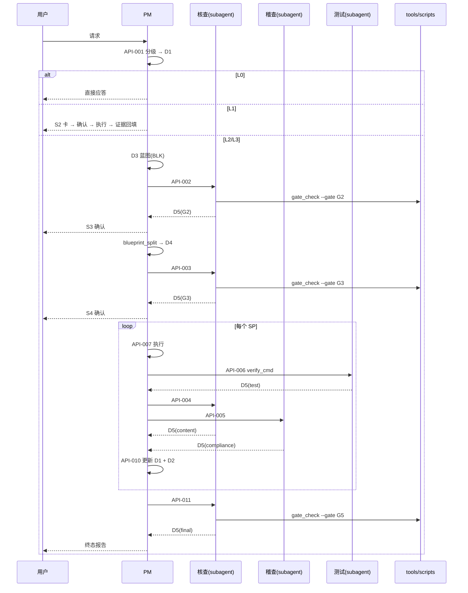

<!-- 创建时间: 2026-10-30 20:55 -->
<!-- 最后修改: 2026-10-30 20:55 -->

# AI Team 治理体系 - 技术设计文档

> 依据：结果蓝图 `agent-doc/result-first/2026-10-30-01-agent流程整改-result-blueprint.md`

---

## 1. 接口定义总表

| 编号 | 方法 | 调用方→被调方 | 请求 | 响应 | 错误码 |
|------|------|--------------|------|------|--------|
| API-001 | `classify` | 路由层→PM | request, status_hint | `{level, goal, acceptance[], verify_cmds[]}` | E-CLS-01 |
| API-002 | `auditBlueprint` | PM→核查 | blueprint, checklist | gate-report.json | E-AUD-01 |
| API-003 | `checkCoverage` | PM→核查 | blueprint, sp_dir, require_machine | gate-report.json | E-COV-01 |
| API-004 | `checkSteps` | PM→核查 | sp, artifacts[] | gate-report.json | E-STEP-01 |
| API-005 | `inspect` | PM→稽查 | task_dir, rule_ids[] | gate-report.json | E-CMP-01 / E-CMP-02 |
| API-006 | `verify` | PM→测试 | sp, verify_cmds[] | `{passed, failed, evidence[]}` | E-TST-01 |
| API-007 | `execute` | PM→代码开发 | sp, tech_stack | `{artifacts[], notes}` | E-DEV-01 |
| API-008 | `load` | 任意→Skill 层 | name | `{body, declaration}` | E-SKL-01 |
| API-009 | `absorb` | PM→Creator | source, target_agent | `{intake_path, verdict, registry_patch}` | E-INT-01 |
| API-010 | `updateStatus` | PM→产物层 | task_id, patch | `{status_path, log_appended}` | E-STS-01 |
| API-011 | `finalCheck` | PM→核查 | blueprint, task_dir | gate-report.json | E-FIN-01 |
| API-012 | `gate_check` | 关卡层→工具层 | --task, --gate | JSON stdout + 退出码 | 退出码 2 |

## 2. 错误码定义

| 码 | 触发条件 | 处理 |
|----|---------|------|
| E-CLS-01 | 无法判定级别（既非纯问答也无明确改动） | 追问 1 次，仍无法定级则按 L2 |
| E-AUD-01 | 蓝图存在"提及未设计"或字段缺失 | 驳回 PM 补蓝图，round+1 |
| E-COV-01 | 存在 BLK 未被任何子计划引用 | 驳回，列出缺失 BLK |
| E-STEP-01 | 子计划步骤未产出或验收断言失败 | 退回代码开发 Agent |
| E-CMP-01 | 违反 R-ID 条款 | 发出整改要求 |
| E-CMP-02 | 越域写入（写了无权限的文件） | 立即阻断，恢复文件 |
| E-TST-01 | `verify_cmd` 非零退出 | 缺陷回传代码开发 Agent |
| E-DEV-01 | 产物路径缺失或为占位/mock | 重做该步 |
| E-SKL-01 | Skill 未在 registry 注册 | 拒绝加载，提示补注册 |
| E-INT-01 | 许可证未知或重叠 >70% 未合并 | 拒绝合入 |
| E-STS-01 | 非法状态迁移（见 R-ST） | 拒绝写入 |
| E-FIN-01 | 终态校验发现 BLK 未覆盖 | 回到执行阶段 |

## 3. 数据设计

### 3.1 产物清单

| ID | 路径 | 产生者 | 消费者 |
|----|------|--------|--------|
| D1 | `agent-doc/tasks/{task_id}/status.md` | PM | 全部 |
| D2 | `agent-doc/tasks/{task_id}/gate-log.jsonl` | PM | 核查/稽查/用户 |
| D3 | `agent-doc/result-first/{date}-{seq}-{name}-result-blueprint.md` | PM | 核查/稽查 |
| D4 | `agent-doc/tasks/{task_id}/plan/SP-XX-{name}.md` | PM（脚本生成 final_result） | 代码开发/核查 |
| D5 | `agent-doc/tasks/{task_id}/reports/{gate}-{kind}-report.json` | 核查/稽查/测试 | 关卡脚本 |
| D6 | `.ai-team/skills/registry.json` | Creator/PM | 全部 Agent |
| D7 | `agent-doc/tasks/{task_id}/intake/{date}-{name}.md` | Creator | PM/用户 |
| D8 | `.ai-team/skills/regression/{skill}/cases.md` | Creator | 测试/PM |

### 3.2 D1 status.md 字段

| 字段 | 类型 | 必填 | 约束 |
|------|------|------|------|
| task_id | string | 是 | `T{yyyy-MMdd}-{seq}` |
| title | string | 是 | ≤40 字 |
| level | enum | 是 | L0/L1/L2/L3 |
| stage | enum | 是 | 分级/蓝图/子计划/执行/终态校验/已完成/阻塞 |
| gate_Gx_status | enum | 是 | 待执行/进行中/通过/不通过/已升级/豁免 |
| gate_Gx_round | int | 是 | 0–2 |
| gate_Gx_report | path | Gx≥2 | 文件存在 |
| acceptance | list | 是 | 每项含 cmd 或 file:line 断言 |
| verify_cmds | list | L2/L3 | 幂等可执行 |
| updated_at | datetime | 是 | `yyyy-MM-dd HH:mm` |

### 3.3 D5 gate-report.json 字段

| 字段 | 类型 | 必填 | 约束 |
|------|------|------|------|
| gate | string | 是 | G1–G5 |
| kind | enum | 是 | blueprint/coverage/content/compliance/test/final |
| task_id | string | 是 | 与目录一致 |
| round | int | 是 | ≥1 |
| verdict | enum | 是 | pass/fail/escalated |
| checked | int | 是 | ≥0 |
| failed | int | 是 | 0 ≤ failed ≤ checked |
| evidence | list | 是 | `{type(file/cmd), ref, result}` |
| blocking | list | fail 必填 | R-ID 或 BLK-ID |
| ts | datetime | 是 | ISO 8601 |

### 3.4 D6 registry.json 结构

```json
{
  "schema": 1,
  "skills": [
    {
      "name": "result-first-definition",
      "version": "1.0.0",
      "path": ".ai-team/skills/pm/result-first-definition/skill.md",
      "trigger": { "keywords": ["结果蓝图", "终态定义"], "agents": ["pm"] },
      "inputs": ["增强后的结构化请求"],
      "outputs": ["agent-doc/result-first/*-result-blueprint.md"],
      "verify": "python tools/scripts/metadata_check.py <blueprint>",
      "source": "internal",
      "owner": "pm"
    }
  ]
}
```

### 3.5 D3 BLK 标记规范

| 命名空间 | 含义 | 示例 |
|---------|------|------|
| FR | 用户交互终态 | `<!-- BLK:FR-001 -->` |
| AR | 架构终态 | `<!-- BLK:AR-001 -->` |
| FN | 功能与交互终态 | `<!-- BLK:FN-001 -->` |
| API | 接口定义 | `<!-- BLK:API-001 -->` |
| TBL | 产物 schema | `<!-- BLK:TBL-001 -->` |
| BIZ | 业务规则 | `<!-- BLK:BIZ-001 -->` |
| NFR | 非功能需求 | `<!-- BLK:NFR-001 -->` |

约束：同一命名空间内序号连续不跳号；每个 BLK 必须有 `blk_owner` 与 `blk_verify` 行。

## 4. 后端处理链路



## 5. 脚本设计

| 脚本 | 入参 | 出参 | 退出码 | 关键逻辑 |
|------|------|------|--------|---------|
| `gate_check.py` | `--task`, `--gate`, 可选 `--report` | JSON stdout | 0/1/2 | 校验 D5 schema；`failed>0` → 1；证据缺失 → 2 |
| `blueprint_split.py` | `--blueprint`, `--map`, `--out` | 生成的 SP 文件 | 0/1 | 按 BLK 抽取；缺失 BLK → 1 |
| `metadata_check.py` | 路径列表 | 违规清单 | 0/1 | 首两行正则 `<!-- (创建时间|最后修改): yyyy-MM-dd HH:mm -->` |
| `registry_lint.py` | 无 | 违规清单 | 0/1 | name 唯一、path 存在、keyword 不交叉、agents 合法 |
| `link_check.py` | 无 | 死链清单 | 0/1 | 扫描 `.md` 中反引号路径与 `](./...)` 链接 |

所有脚本禁止：写业务文件、联网、读取 `agent-doc/tasks/*/gate-log.jsonl` 以外目录以外的东西（只读校验）。

## 6. 测试策略

| 层级 | 对象 | 方式 |
|------|------|------|
| 脚本单测 | 5 个 Python 脚本 | `python -m unittest tools/scripts/tests` |
| 契约测试 | D1/D5/D6 JSON | `gate_check.py` + `registry_lint.py` |
| 端到端 | 一次 L2 任务 | 跑通 G1–G5，产出 5 份 D5 |
| 回归 | Skill 行为 | `.ai-team/skills/regression/**/cases.md` |
| 死链 | 全仓文档 | `link_check.py` 退出码 0 |
