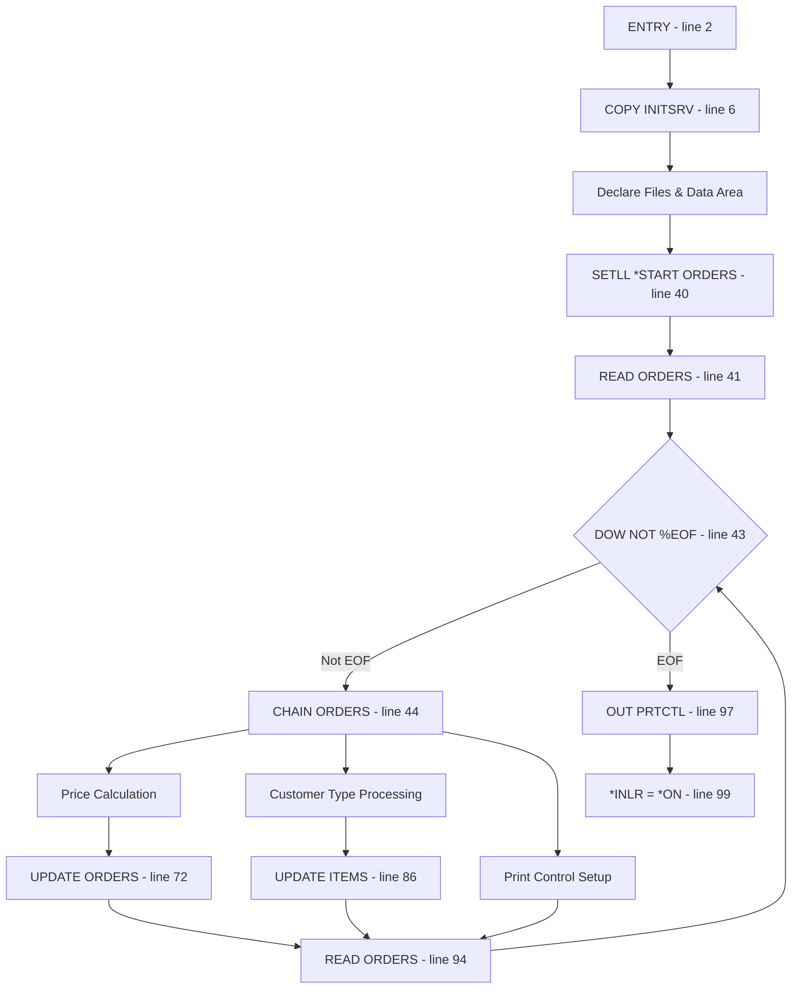
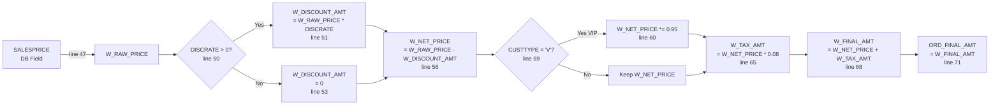
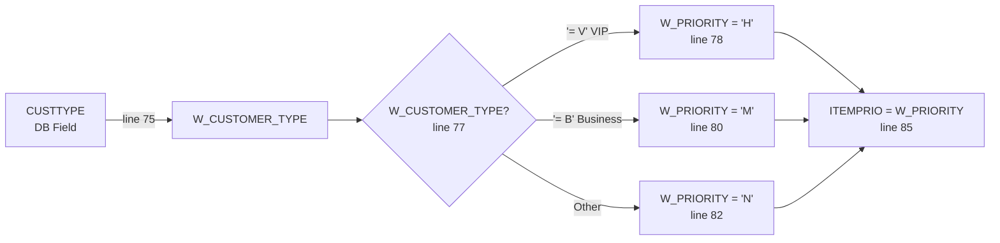
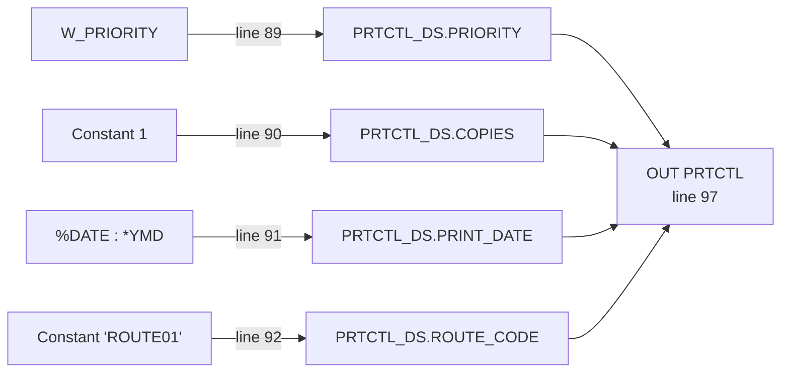

# Program Analysis: FIELDCHAIN

## 1. Overview

| Item | Value |
|------|-------|
| Program Name | FIELDCHAIN |
| Type | RPGLE |
| Entry Points | MAIN (line 2) |
| Files | 2 (ORDERS, ITEMS) |
| Data Areas | 1 (PRTCTL) |
| Program Calls | 0 |
| COPY/INCLUDE | 1 (QRPGLESRC,INITSRV) |

---

## 2. Program Flow



---

## 3. Data Flow

### 3.1 Price Calculation Chain



### 3.2 Customer Priority Chain



### 3.3 Print Control Chain



---

## 4. Business Logic

### 4.1 Calculations

| Formula | Expression | Line | Condition |
|---------|------------|------|-----------|
| Raw Price | SALESPRICE | 47 | Always |
| Discount Amount | W_RAW_PRICE * DISCRATE | 51 | DISCRATE > 0 |
| Discount Amount | 0 | 53 | DISCRATE = 0 |
| Net Price | W_RAW_PRICE - W_DISCOUNT_AMT | 56 | Always |
| VIP Discount | W_NET_PRICE * 0.95 | 60 | CUSTTYPE = 'V' |
| Tax Rate | 0.08 | 64 | Always |
| Tax Amount | W_NET_PRICE * W_TAX_RATE | 65 | Always |
| Final Amount | W_NET_PRICE + W_TAX_AMT | 68 | Always |

### 4.2 Business Rules

| Rule | Condition | Action | Line |
|------|-----------|--------|------|
| Discount calculation | DISCRATE > 0 | Apply percentage discount | 51 |
| No discount | DISCRATE = 0 | Set discount amount to 0 | 53 |
| VIP discount | CUSTTYPE = 'V' | Additional 5% discount | 60 |
| VIP priority | W_CUSTOMER_TYPE = 'V' | Set priority 'H' (High) | 78 |
| Business priority | W_CUSTOMER_TYPE = 'B' | Set priority 'M' (Medium) | 80 |
| Normal priority | Other types | Set priority 'N' (Normal) | 82 |

### 4.3 Constants

| Constant | Value | Usage | Line |
|----------|-------|-------|------|
| Tax Rate | 0.08 | 8% tax rate | 64 |
| VIP Discount | 0.95 | 5% VIP discount | 60 |
| Copies | 1 | Print copies | 90 |
| Route Code | 'ROUTE01' | Default route | 92 |

---

## 5. Data Dictionary

| Field | Type | Source | Business Meaning | Line |
|-------|------|--------|------------------|------|
| SALESPRICE | PACKED(11:2) | DB | Original sales price | 47 |
| DISCRATE | PACKED(5:2) | DB | Discount rate (percentage) | 51 |
| CUSTTYPE | CHAR(1) | DB | Customer type (V=Biz, B=Biz, other) | 75 |
| ORD_FINAL_AMT | PACKED(11:2) | DB | Final order amount (written back) | 71 |
| ITEMPRIO | CHAR(1) | DB | Item priority level (written back) | 85 |
| W_RAW_PRICE | PACKED(11:2) | Work | Working raw price | 47 |
| W_DISCOUNT_AMT | PACKED(11:2) | Work | Calculated discount amount | 51/53 |
| W_NET_PRICE | PACKED(11:2) | Work | Price after discount | 56/60 |
| W_TAX_RATE | PACKED(3:2) | Const | Tax rate (0.08) | 64 |
| W_TAX_AMT | PACKED(9:2) | Work | Calculated tax amount | 65 |
| W_FINAL_AMT | PACKED(11:2) | Work | Final amount before write | 68 |
| W_CUSTOMER_TYPE | CHAR(1) | Work | Customer type copy | 75 |
| W_PRIORITY | CHAR(1) | Work | Priority code (H/M/N) | 78-82 |

---

## 6. Table Operations

### ORDERS (INPUT/OUTPUT)

| Field | Operation | Expression | Condition | Written | Line |
|-------|-----------|------------|-----------|---------|------|
| W_RAW_PRICE | ASSIGN | SALESPRICE | Always | Y | 47 |
| W_DISCOUNT_AMT | ASSIGN | W_RAW_PRICE * DISCRATE | DISCRATE > 0 | Y | 51 |
| W_DISCOUNT_AMT | ASSIGN | 0 | DISCRATE = 0 | Y | 53 |
| W_NET_PRICE | ASSIGN | W_RAW_PRICE - W_DISCOUNT_AMT | Always | Y | 56 |
| W_NET_PRICE | ASSIGN | W_NET_PRICE * 0.95 | CUSTTYPE = 'V' | Y | 60 |
| W_TAX_RATE | ASSIGN | 0.08 | Always | Y | 64 |
| W_TAX_AMT | ASSIGN | W_NET_PRICE * W_TAX_RATE | Always | Y | 65 |
| W_FINAL_AMT | ASSIGN | W_NET_PRICE + W_TAX_AMT | Always | Y | 68 |
| ORD_FINAL_AMT | ASSIGN | W_FINAL_AMT | Always | Y | 71 |
| W_CUSTOMER_TYPE | ASSIGN | CUSTTYPE | Always | Y | 75 |
| W_PRIORITY | ASSIGN | 'H' | W_CUSTOMER_TYPE = 'V' | Y | 78 |
| W_PRIORITY | ASSIGN | 'M' | W_CUSTOMER_TYPE = 'B' | Y | 80 |
| W_PRIORITY | ASSIGN | 'N' | Other | Y | 82 |
| ITEMPRIO | ASSIGN | W_PRIORITY | Always | Y | 85 |

### ITEMS (INPUT/OUTPUT)

| Field | Operation | Expression | Condition | Written | Line |
|-------|-----------|------------|-----------|---------|------|
| ITEMPRIO | ASSIGN | W_PRIORITY | Always | Y | 85 |

---

## 7. Data Area: PRTCTL

| Field | Offset | Source | Value | Line |
|-------|--------|--------|-------|------|
| PRINT_DATE | 0 | %CHAR(%DATE(): *YMD) | Current date (YMD) | 91 |
| PRINT_TIME | 8 | - | Not set | - |
| COPIES | 14 | Constant | 1 | 90 |
| PRIORITY | 17 | W_PRIORITY | H/M/N | 89 |
| ROUTE_CODE | 18 | Constant | 'ROUTE01' | 92 |

---

## 8. Error Handling

| Condition | Handling | Line |
|-----------|----------|------|
| EOF on ORDERS | Exit loop, write Data Area | 43/97 |
| DISCRATE = 0 | Set discount to 0 | 53 |
| Invalid customer type | Default to priority 'N' | 82 |

---

## 9. Migration Notes

### Field Mapping

| RPG Field | Java Field | Type | Notes |
|-----------|------------|------|-------|
| SALESPRICE | order.salesPrice | BigDecimal | Source price |
| DISCRATE | order.discRate | BigDecimal | Discount rate |
| CUSTTYPE | customer.type | String | V=Biz, B=Biz, other |
| ORD_FINAL_AMT | order.finalAmount | BigDecimal | Final amount |
| ITEMPRIO | order.itemPriority | String | H/M/N |

### Business Rules to Preserve

1. Discount only applies when DISCRATE > 0
2. VIP customers (type 'V') get additional 5% discount
3. Tax rate is fixed at 8%
4. Priority mapping: V→H, B→M, others→N
5. PRTCTL Data Area stores print control info

### Calculation Formulas

```
finalAmount = salesPrice 
              - (salesPrice * discRate if discRate > 0 else 0)
              * (0.95 if custType = 'V' else 1.0)
              * 1.08
```

### Edge Cases

- DISCRATE = 0: No discount applied
- DISCRATE < 0: Not handled (potential bug)
- CUSTTYPE not in ('V', 'B'): Default priority 'N'
- Multiple VIP discounts: Only one 5% applied
