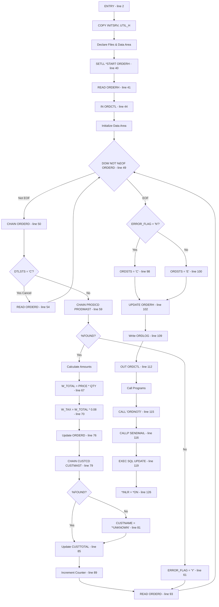
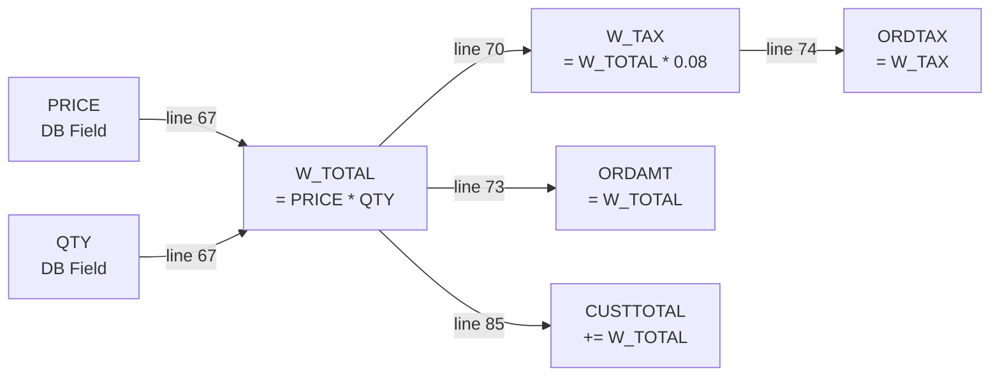
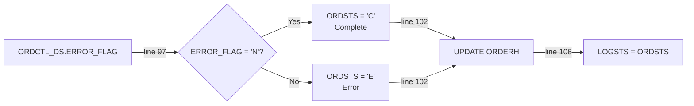
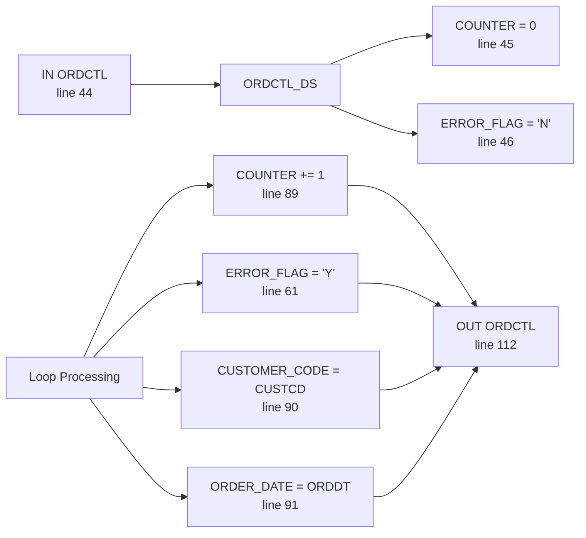

# Program Analysis: ORDPROC

## 1. Overview

| Item | Value |
|------|-------|
| Program Name | ORDPROC |
| Type | RPGLE |
| Entry Points | MAIN (line 2) |
| Files | 5 (ORDERH, ORDERD, CUSTMAST, PRODMAST, ORDLOG) |
| Data Areas | 1 (ORDCTL) |
| Program Calls | 2 (ORDNOTI, SENDMAIL) |
| COPY/INCLUDE | 2 (QRPGLESRC/INITSRV, QPROTOSRC/UTIL_H) |

---

## 2. Program Flow



---

## 3. Data Flow

### 3.1 Amount Calculation Chain



### 3.2 Status Control Chain



### 3.3 Data Area Flow



---

## 4. Business Logic

### 4.1 Calculations

| Formula | Expression | Line | Condition |
|---------|------------|------|-----------|
| Total Amount | PRICE * QTY | 67 | Always |
| Tax Amount | W_TOTAL * 0.08 | 70 | Always |
| Customer Total | CUSTTOTAL + W_TOTAL | 85 | Always |

### 4.2 Business Rules

| Rule | Condition | Action | Line |
|------|-----------|--------|------|
| Skip cancelled | DTLSTS = 'C' | Skip to next record | 53-56 |
| Product not found | NOT %FOUND | Set error flag, skip | 60-64 |
| Customer not found | NOT %FOUND | Set name to '*UNKNOWN' | 80-82 |
| Order complete | ERROR_FLAG = 'N' | Set status 'C' | 98 |
| Order error | ERROR_FLAG = 'Y' | Set status 'E' | 100 |

### 4.3 Constants

| Constant | Value | Usage | Line |
|----------|-------|-------|------|
| Tax Rate | 0.08 | 8% tax rate | 70 |
| Processing Status | 'P' | Order detail processing | 75 |
| Complete Status | 'C' | Order completed | 98 |
| Error Status | 'E' | Order has errors | 100 |
| Cancelled Status | 'C' | Detail cancelled | 53 |
| Unknown Customer | '*UNKNOWN' | Default name | 81 |

---

## 5. Data Dictionary

| Field | Type | Source | Business Meaning | Line |
|-------|------|--------|------------------|------|
| ORDNO | CHAR(10) | DB | Order number | 105 |
| ORDDT | CHAR(8) | DB | Order date | 91 |
| ORDSTS | CHAR(1) | DB | Order status (C/E/P) | 75/98/100 |
| CUSTCD | CHAR(5) | DB | Customer code | 79/90 |
| CUSTNAME | CHAR(30) | DB | Customer name | 81 |
| CUSTTOTAL | PACKED(11:2) | DB | Customer cumulative total | 85 |
| PRODCD | CHAR(10) | DB | Product code | 59 |
| PRICE | PACKED(11:2) | DB | Unit price | 67 |
| QTY | PACKED(5:0) | DB | Quantity | 67 |
| DTLSTS | CHAR(1) | DB | Detail status (C=Cancelled) | 53 |
| ORDAMT | PACKED(11:2) | DB | Order amount (written) | 73 |
| ORDTAX | PACKED(9:2) | DB | Order tax (written) | 74 |
| W_TOTAL | PACKED(11:2) | Work | Calculated total | 67 |
| W_TAX | PACKED(9:2) | Work | Calculated tax | 70 |
| W_COUNT | INT(5) | Work | Counter | 32 |
| W_STATUS | CHAR(1) | Work | Status code | 33 |

---

## 6. Table Operations

### ORDERH (INPUT)

| Field | Operation | Expression | Condition | Written | Line |
|-------|-----------|------------|-----------|---------|------|
| LOGORD | ASSIGN | ORDNO | Always | Y | 105 |
| LOGSTS | ASSIGN | ORDSTS | Always | Y | 106 |
| LOGCNT | ASSIGN | ORDCTL_DS.COUNTER | Always | Y | 107 |
| LOGTIME | ASSIGN | %TIMESTAMP() | Always | Y | 108 |

### ORDERD (INPUT/OUTPUT)

| Field | Operation | Expression | Condition | Written | Line |
|-------|-----------|------------|-----------|---------|------|
| W_TOTAL | ASSIGN | PRICE * QTY | Always | Y | 67 |
| W_TAX | ASSIGN | W_TOTAL * 0.08 | Always | Y | 70 |
| ORDAMT | ASSIGN | W_TOTAL | Always | Y | 73 |
| ORDTAX | ASSIGN | W_TAX | Always | Y | 74 |
| ORDSTS | ASSIGN | 'P' | Always | Y | 75 |

### CUSTMAST (INPUT)

| Field | Operation | Expression | Condition | Written | Line |
|-------|-----------|------------|-----------|---------|------|
| CUSTNAME | ASSIGN | '*UNKNOWN' | NOT %FOUND | Y | 81 |
| CUSTTOTAL | ASSIGN | CUSTTOTAL + W_TOTAL | Always | Y | 85 |

### ORDLOG (OUTPUT)

| Field | Operation | Expression | Condition | Written | Line |
|-------|-----------|------------|-----------|---------|------|
| LOGORD | ASSIGN | ORDNO | Always | Y | 105 |
| LOGSTS | ASSIGN | ORDSTS | Always | Y | 106 |
| LOGCNT | ASSIGN | ORDCTL_DS.COUNTER | Always | Y | 107 |
| LOGTIME | ASSIGN | %TIMESTAMP() | Always | Y | 108 |

---

## 7. Data Area: ORDCTL

| Field | Offset | Source | Value | Line |
|-------|--------|--------|-------|------|
| STATUS | 0 | - | - | - |
| COUNTER | 1 | Increment | 0 → N | 45/89 |
| ORDER_DATE | 6 | ORDDT | Order date | 91 |
| CUSTOMER_CODE | 14 | CUSTCD | Customer code | 90 |
| ERROR_FLAG | 19 | Flag | N/Y | 46/61 |

---

## 8. Error Handling

| Condition | Handling | Line |
|-----------|----------|------|
| EOF on ORDERD | Exit loop | 49 |
| Detail cancelled (DTLSTS='C') | Skip to next | 53-56 |
| Product not found | Set ERROR_FLAG='Y', skip | 60-64 |
| Customer not found | Set CUSTNAME='*UNKNOWN' | 80-82 |
| Any error occurred | Set ORDSTS='E' | 100 |

---

## 9. Program Calls

| Program | Type | Line | Purpose |
|---------|------|------|---------|
| ORDNOTI | CALL | 115 | Order notification |
| SENDMAIL | CALLP | 116 | Send email notification |

---

## 10. Migration Notes

### Field Mapping

| RPG Field | Java Field | Type | Notes |
|-----------|------------|------|-------|
| ORDNO | order.orderNo | String | Order number |
| ORDDT | order.orderDate | String | Order date |
| ORDSTS | order.status | String | C=Complete, E=Error |
| CUSTCD | customer.code | String | Customer code |
| CUSTNAME | customer.name | String | Customer name |
| CUSTTOTAL | customer.totalAmount | BigDecimal | Cumulative total |
| PRODCD | product.code | String | Product code |
| PRICE | product.price | BigDecimal | Unit price |
| QTY | orderDetail.quantity | int | Quantity |
| ORDAMT | orderDetail.amount | BigDecimal | Line amount |
| ORDTAX | orderDetail.tax | BigDecimal | Line tax |

### Business Rules to Preserve

1. Skip cancelled details (status = 'C')
2. Set error flag if product not found
3. Set customer name to '*UNKNOWN' if not found
4. Tax rate is fixed at 8%
5. Update customer cumulative total
6. Write audit log for each order
7. Call notification programs after processing
8. Update ORDERH status via SQL

### Calculation Formulas

```
lineAmount = unitPrice * quantity
lineTax = lineAmount * 0.08
customerTotal += lineAmount
orderStatus = (hasError) ? 'E' : 'C'
```

### Edge Cases

- Product not found: Error flag set, order continues
- Customer not found: Name set to '*UNKNOWN', amount still accumulated
- Cancelled detail: Skipped entirely
- Multiple errors: ERROR_FLAG stays 'Y' once set
- SQL update after RPG update: Potential race condition

### External Dependencies

- ORDNOTI: Order notification program (must exist)
- SENDMAIL: Email sending procedure (must exist)
- QRPGLESRC/INITSRV: Initialization routine
- QPROTOSRC/UTIL_H: Utility functions
