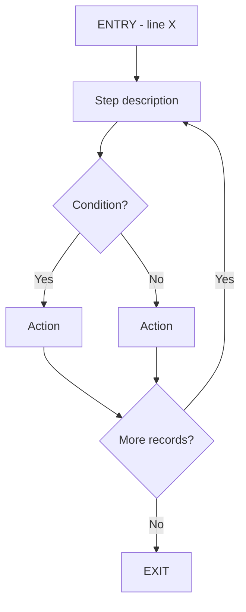
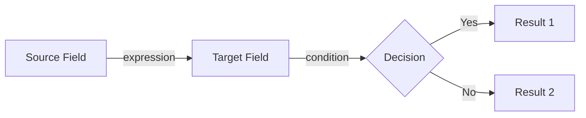

# IBM i Program Analysis Report - Prompt Template

## How to Use

### Step 1: AI Reads Files
AI should read:
1. JSON analysis file (provided path)
2. Source code file (provided path)

### Step 2: AI Formats Prompt
AI replaces placeholders:
- `{json_content}` → Content from JSON file
- `{source_code}` → Content from source file
- `{PROGRAM_NAME}` → From JSON meta.program_name

### Step 3: AI Generates Report
AI processes the formatted prompt and generates the report.

### Step 4: AI Saves Output
AI saves report to `tools/ibmi-analyzer/reports/{PROGRAM_NAME}-analysis.md`

---

## Prompt Template

```markdown
### Task
Generate a comprehensive analysis report for IBM i program: {PROGRAM_NAME}

### Input Data

#### JSON Analysis
```json
{json_content}
```

#### Source Code
```rpgle
{source_code}
```

### Report Structure

Generate a markdown report with the following sections:

## 1. Overview

| Item | Value |
|------|-------|
| Program Name | {name} |
| Type | {RPGLE/CL/COBOL} |
| Entry Points | {list with line numbers} |
| Files | {count} ({names}) |
| Data Areas | {count} ({names}) |
| Program Calls | {count} ({names}) |
| COPY/INCLUDE | {count} ({names}) |

## 2. Program Flow

Create a Mermaid flowchart:


## 3. Data Flow

For each major flow, create a Mermaid diagram:


## 4. Business Logic

### 4.1 Calculations

| Formula | Expression | Line | Condition |
|---------|------------|------|-----------|
| {name} | {expression} | {line} | {condition} |

### 4.2 Business Rules

| Rule | Condition | Action | Line |
|------|-----------|--------|------|
| {rule name} | {condition} | {action} | {line} |

### 4.3 Constants

| Constant | Value | Usage | Line |
|----------|-------|-------|------|
| {name} | {value} | {description} | {line} |

## 5. Data Dictionary

| Field | Type | Source | Business Meaning | Line |
|-------|------|--------|------------------|------|
| {name} | {type} | {DB/Calc/Const} | {inferred meaning} | {line} |

## 6. Table Operations

### {TABLE_NAME} ({USAGE})

| Field | Operation | Expression | Condition | Written | Line |
|-------|-----------|------------|-----------|---------|------|
| {name} | {op} | {expr} | {cond} | {Y/N} | {line} |

## 7. Data Area: {NAME}

| Field | Offset | Source | Value | Line |
|-------|--------|--------|-------|------|
| {name} | {offset} | {source} | {value} | {line} |

## 8. Error Handling

| Condition | Handling | Line |
|-----------|----------|------|
| {condition} | {action} | {line} |

## 9. Migration Notes

### Field Mapping

| RPG Field | Java Field | Type | Notes |
|-----------|------------|------|-------|
| {name} | {suggestion} | {type} | {notes} |

### Business Rules to Preserve

1. {rule}
2. {rule}

### Calculation Formulas

```
{formula in pseudocode}
```

### Edge Cases

- {case}
```

---

## Field Name Inference Rules

| Pattern | Meaning |
|---------|---------|
| xxxNO, xxxNUM | Number/ID |
| xxxDT, xxxDATE | Date |
| xxxAMT, xxxPRC | Amount/Price |
| xxxQTY | Quantity |
| xxxRTE, xxxRATE | Rate |
| xxxCD, xxxCODE | Code |
| xxxFLG, xxxIND | Flag/Indicator |
| W_xxx | Work variable |
| ORD_xxx | Order-related |
| CUST_xxx | Customer-related |
| PRD_xxx | Product-related |

## Diagram Rules

1. Use `flowchart TD` for main program flow (top-down)
2. Use `flowchart LR` for data flow (left-right)
3. Include line numbers in node labels
4. Show conditions on decision edges
5. Group related flows into subgraphs
6. Use meaningful node labels (not just A, B, C)
