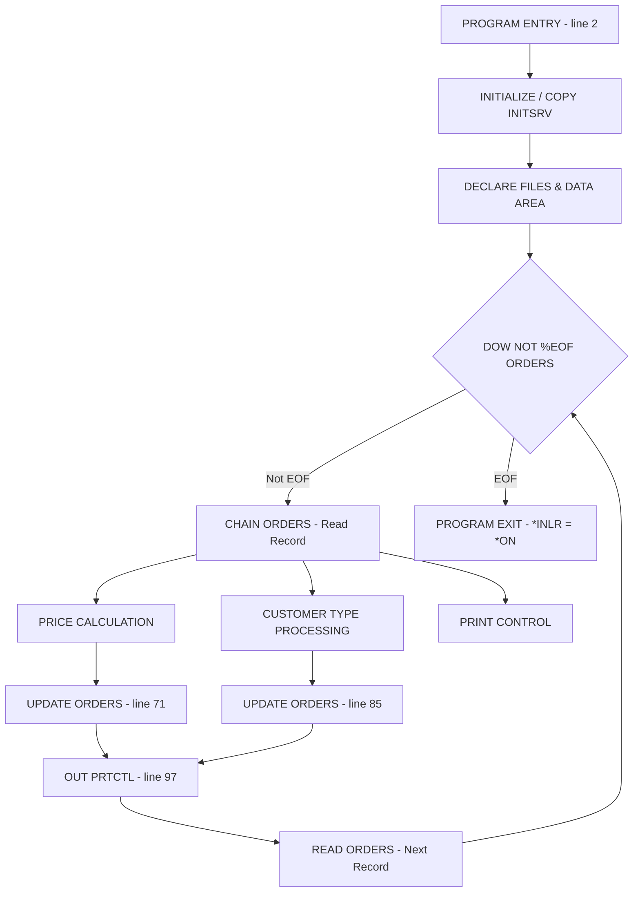
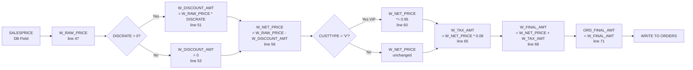
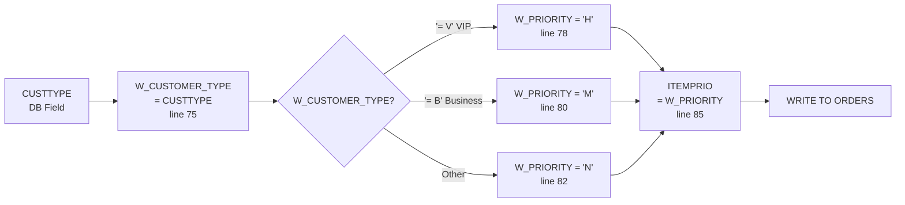
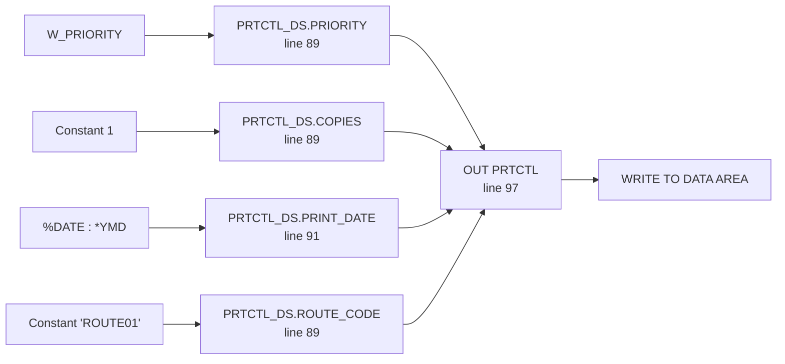

# Program Analysis: FIELDCHAIN

## 1. Overview

| Item | Value |
|------|-------|
| Program Name | FIELDCHAIN |
| Type | RPGLE |
| Entry Point | MAIN (line 2) |
| Files Used | 2 (ORDERS, ITEMS) |
| Data Areas | 1 (PRTCTL) |
| Program Calls | 0 |
| External References | /COPY QRPGLESRC,INITSRV |

---

## 2. Program Flow



---

## 3. Field Propagation Chains

### 3.1 Price Calculation Chain



### 3.2 Customer Priority Chain



### 3.3 Print Control Chain



---

## 4. Data Area Structure

**PRTCTL** (100 bytes, CHAR)

| Offset | Field | Source | Value | Line |
|--------|-------|--------|-------|------|
| 0 | PRINT_DATE | %CHAR(%DATE(): *YMD) | Current date (YMD) | 91 |
| 8 | PRINT_TIME | - | - | - |
| 14 | COPIES | Constant | 1 | 89 |
| 17 | PRIORITY | W_PRIORITY | H/M/N | 89 |
| 18 | ROUTE_CODE | Constant | 'ROUTE01' | 89 |

---

## 5. Business Logic

| Rule | Condition | Action | Line |
|------|-----------|--------|------|
| Discount calculation | DISCRATE > 0 | W_DISCOUNT_AMT = W_RAW_PRICE * DISCRATE | 51 |
| No discount | DISCRATE = 0 | W_DISCOUNT_AMT = 0 | 53 |
| VIP discount | CUSTTYPE = 'V' | W_NET_PRICE *= 0.95 | 60 |
| Tax rate | Always | W_TAX_RATE = 0.08 | 64 |
| VIP priority | W_CUSTOMER_TYPE = 'V' | W_PRIORITY = 'H' | 78 |
| Business priority | W_CUSTOMER_TYPE = 'B' | W_PRIORITY = 'M' | 80 |
| Normal priority | Other | W_PRIORITY = 'N' | 82 |

---

## 6. Table Operations

**ORDERS** (INPUT/OUTPUT)

| Field | Operation | Expression | Written | Line |
|-------|-----------|------------|---------|------|
| W_RAW_PRICE | ASSIGN | SALESPRICE | ✅ | 47 |
| W_DISCOUNT_AMT | ASSIGN | W_RAW_PRICE * DISCRATE | ✅ | 51 |
| W_DISCOUNT_AMT | ASSIGN | 0 | ✅ | 53 |
| W_NET_PRICE | ASSIGN | W_RAW_PRICE - W_DISCOUNT_AMT | ✅ | 56 |
| W_NET_PRICE | ASSIGN | W_NET_PRICE * 0.95 | ✅ | 60 |
| W_TAX_RATE | ASSIGN | 0.08 | ✅ | 64 |
| W_TAX_AMT | ASSIGN | W_NET_PRICE * W_TAX_RATE | ✅ | 65 |
| W_FINAL_AMT | ASSIGN | W_NET_PRICE + W_TAX_AMT | ✅ | 68 |
| ORD_FINAL_AMT | ASSIGN | W_FINAL_AMT | ✅ | 71 |
| W_CUSTOMER_TYPE | ASSIGN | CUSTTYPE | ✅ | 75 |
| W_PRIORITY | ASSIGN | 'H' / 'M' / 'N' | ✅ | 78-82 |
| ITEMPRIO | ASSIGN | W_PRIORITY | ✅ | 85 |

---

## 7. Migration Notes

### Key Fields for Java Migration

| RPG Field | Java Equivalent | Type | Description |
|-----------|-----------------|------|-------------|
| SALESPRICE | order.salesPrice | BigDecimal | Source price from DB |
| DISCRATE | order.discRate | BigDecimal | Discount rate |
| CUSTTYPE | customer.type | String | Customer type (V/B/other) |
| ORD_FINAL_AMT | order.finalAmount | BigDecimal | Final calculated amount |
| ITEMPRIO | order.itemPriority | String | Priority level (H/M/N) |

### Business Rules to Preserve

1. Discount only applies when DISCRATE > 0
2. VIP customers get additional 5% discount
3. Tax rate is fixed at 8%
4. Priority mapping: V→H, B→M, others→N
5. PRTCTL Data Area stores print control info

### Calculation Formula

```
finalAmount = salesPrice 
              - (salesPrice * discRate if discRate > 0 else 0)
              * (0.95 if custType = 'V' else 1.0)
              * 1.08
```
